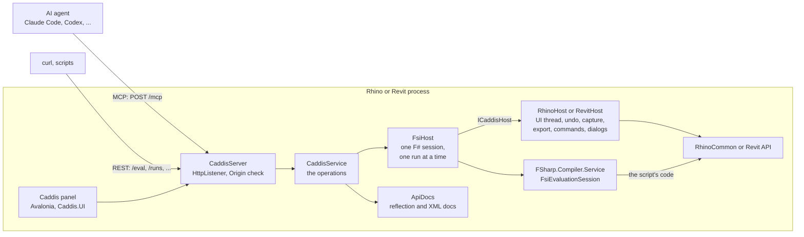
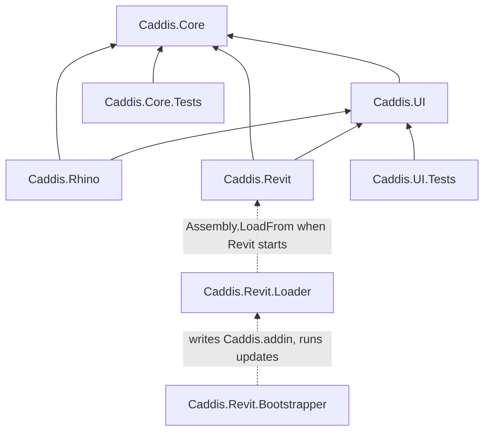
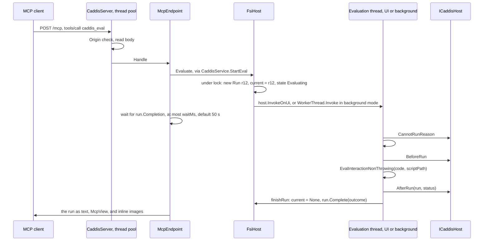

# Caddis architecture

How Caddis is built: its projects, libraries and namespaces, how a request turns into F# code running inside Rhino or Revit,
its features and API, and what it does not do, by design or not yet.

For what Caddis does, how to install it and how to connect an agent, see the [README](README.md),
[Caddis for Rhino](Caddis.Rhino/README.md) and [Caddis for Revit](Caddis.Revit/README.md).

This describes the code of version 0.2.1 plus the unreleased changes in [CHANGELOG.md](CHANGELOG.md), as of October 2026.

## Contents

1. [Overview](#1-overview)
2. [Features](#2-features)
3. [Repository layout](#3-repository-layout)
4. [Runtimes and versions](#4-runtimes-and-versions)
5. [Libraries](#5-libraries)
6. [Namespaces and modules](#6-namespaces-and-modules)
7. [How the core works](#7-how-the-core-works)
8. [API reference](#8-api-reference)
9. [The shared panel: Caddis.UI](#9-the-shared-panel-caddisui)
10. [Rhino: Caddis.Rhino](#10-rhino-caddisrhino)
11. [Revit: Caddis.Revit, the loader and the bootstrapper](#11-revit-caddisrevit-the-loader-and-the-bootstrapper)
12. [Build, versioning, CI and releases](#12-build-versioning-ci-and-releases)
13. [Tests](#13-tests)
14. [What is not there](#14-what-is-not-there)
15. [Known limitations and risks](#15-known-limitations-and-risks)
16. [Identifiers, ports and paths](#16-identifiers-ports-and-paths)

---

## 1. Overview

Caddis hosts an F# Interactive (FSI) session inside the process of Rhino or Revit, and an HTTP server in the same process
through which AI agents and scripts run F# code in that session.
The agent writes RhinoCommon or Revit API code, Caddis compiles and runs it inside the app and returns what happened:
as text written for the model via MCP, or as JSON via REST.



Everything that does not depend on the app is in **Caddis.Core**: the F# session, runs, the HTTP server, REST and MCP.
An app plugs in by implementing one interface, `ICaddisHost`, and supplying its texts and names in a `HostInfo` record.
**Caddis.UI** is a panel shared by both apps. **Caddis.Rhino** and **Caddis.Revit** are the two hosts.
**Caddis.Revit.Loader** and **Caddis.Revit.Bootstrapper** exist only to deploy into Revit.

### Design decisions

| Decision | Why |
|---|---|
| One persistent F# session per app process, shared by all clients | Values, functions and types of one run are used by later runs, so an agent builds up state step by step. |
| One run at a time. A request while a run is in progress gets HTTP 409 or an MCP tool error, it is not queued | Runs change a live document; order and undo stay predictable. |
| The thread mode applies to the whole session: the app's UI thread (default) or a background thread. Changing it resets the session | The UI thread is safe for the app's API but blocks the app and can't be cancelled; the background thread can be cancelled and timed out. |
| `System.Net.HttpListener`, not Kestrel | Rhino 8 loads only the frameworks Microsoft.NETCore.App and Microsoft.WindowsDesktop.App, not ASP.NET Core. |
| MCP written by hand, a JSON-RPC subset, not the MCP C# SDK | The SDK needs newer `Microsoft.Extensions.*` and `System.Diagnostics.DiagnosticSource` packages, which conflict with what Rhino 8 loads. |
| JSON with the in-box `System.Text.Json` (`JsonNode`), no other JSON library | No extra dependencies that could conflict with the app's or another plugin's. |
| FSharp.Compiler.Service and FSharp.Core pinned per runtime, to the versions of Fesh | Caddis and Fesh.Rhino or Fesh.Revit can load into the same process, which gets only one FSharp.Core. |
| MCP results are plain text and images, without `structuredContent` | Claude Code shows the model only the `structuredContent` of a result that has one ([claude-code#55677](https://github.com/anthropics/claude-code/issues/55677)). |
| Localhost only, requests with an `Origin` header rejected, no authentication | Other computers and web pages can't call it. Every program on the computer can, and run any code with the user's rights. |

---

## 2. Features

**F# session**
- One persistent F# Interactive session per app. Definitions stay until `caddis_reset`, a mode change, or a reset after an abandoned run.
- Code is sent inline or as the path of an `.fsx` file. With a path, `__SOURCE_DIRECTORY__`, relative `#load` and `#r`, and line numbers in stack traces refer to that file.
- `#r "nuget: ..."` works if the .NET SDK is installed on the machine.
- Conditional compilation symbols: `CADDIS`, the app (`RHINO`, `REVIT`, `HEADLESS` in tests), `NET` and `NETCOREAPP` or `NETFRAMEWORK`, and FSI's own `INTERACTIVE`.
- More FSI arguments via `extraFsiArgs` in the settings file. Arguments that would make FCS exit the process, e.g. `--help`, are dropped with a message.
- Runs on the UI thread or on a background thread; in background mode `Caddis.Script.OnUi` calls into the app on its UI thread.
- Background runs can be cancelled and timed out. A run that ignores cancellation for 5 s is abandoned and the session is reset.
- Long runs: `caddis_eval` returns status `running` after `waitMs` (50 s by default) and keeps running; `caddis_get_run` waits for it and can return only new stdout via `stdoutOffset`.
- Type-check without running, against the current session, so definitions of earlier runs are known (`caddis_check`).
- API lookup: signatures in F# syntax with XML doc summaries for namespaces, types and members of all loaded assemblies, a name search, and suggestions for misspelled names (`caddis_describe`).

**Results of a run**
- Status, the type and printed value of the last expression, stdout, stderr, FSI's own output, what was printed to the app's command line, compiler diagnostics with 1-based positions, the exception with the line in the script, notes of the app, e.g. Revit's warnings, the ids of created, changed and deleted objects, and the files the run saved to `Caddis.Script.OutDir`.
- Via MCP as compact text: empty parts left out, long output shortened at line ends with its start and end kept and the full text saved to a file, stack traces cut to the frames that lead into the script, images inline.
- Via REST as JSON with all fields.

**Operations in the app**
- Undo of a run: each run is one undo step.
- Viewport capture as PNG, with size and display mode.
- Export to the file formats of the app, as a run with its files.
- Rhino: command macros like typed at the command line (`caddis_command`), with cancellation of commands that wait for input; a yellow border around the viewports while a run is in progress; echo of script output to the command line; the SynchronizationContext for Rhino.Scripting and its Esc state cleared before each run; the MCP instructions suggest Rhino.Scripting.FSharp when NuGet packages can be used.
- Revit: runs in Revit's API context through an external event; a transaction group per run, rolled back if the run fails; Revit's warnings as notes and errors as rolled-back transactions instead of dialogs; changed elements counted per category; listing Revit's blocking dialogs and pressing their buttons (`caddis_dialog`).

**Server**
- MCP over Streamable HTTP at `/mcp`, with single JSON responses, and plain REST endpoints.
- Localhost only, without authentication; `Origin` header rejected; request bodies up to 20 MB.
- Its own port and MCP name per app, 7810 `caddis-rhino` and 7820 `caddis-revit`, so both can run and stay registered at the same time. The next free port if one is taken.
- A second instance of an app, e.g. another Revit, takes over the port where the agents connect from the first one once that is idle (`POST /release`); agents connected to the port go on with it.
- A discovery file per running server in `instances/<pid>.json`.

**User interface**
- A dockable panel in both apps, in the app's light or dark theme: server state, whether Claude Code, Codex and Claude Desktop connect to this app with `Set up` and `Activate`, settings, an `Errors` list, the recent runs, the output and the code of the selected run with F# highlighting, Fantomas formatting, `Run again`, `Export` and `Export all` to `.fsx`.
- Rhino: the command `Caddis` with options, scriptable as `-Caddis`.
- Revit: a `Caddis` ribbon tab with vector icons drawn for the theme and screen scale, native checkboxes, and an `Info` dialog that turns red on unseen errors.

**Deployment**
- Rhino: two Yak packages per version, `rh8_19` (net8.0 and net48 builds) and `rh9_0` (net10.0).
- Revit: one signed Velopack installer for Revit 2024 to 2027 that registers every installed Revit, checks for updates when Revit starts and installs them after the last Revit has closed. A loader picks the build for the .NET that Revit runs on.

---

## 3. Repository layout

```
Caddis.slnx                    the solution
Directory.Build.props          shared MSBuild settings: version from CHANGELOG.md, FSharp.Core per project, XML docs, warnings
Directory.Build.targets        drops unused SkiaSharp and HarfBuzz native libraries from net48 builds
CHANGELOG.md                   Keep a Changelog, the source of the version
README.md  Architecture.md  LICENSE (MIT)
Caddis.Core/                   F# session, runs, HTTP server, REST, MCP, API docs. No Rhino or Revit dependency
  Http/                        transport types, REST router, MCP endpoint and its text view
Caddis.UI/                     the shared Avalonia panel
Caddis.Rhino/                  the Rhino plugin, a .rhp, and yak.yml
Caddis.Revit/                  the Revit add-in, and install-dev.ps1
Caddis.Revit.Loader/           C# add-in for Revit 2025 and later, loads the net8.0 or net10.0 build
Caddis.Revit.Bootstrapper/     the Velopack app of the Revit installer
Dev/                           a .cmd per app, e.g. Rhino8.cmd, and Start-Dev.ps1: start Rhino or Revit with a local build instead of the installed Caddis
Tests/Caddis.Core.Tests/       xUnit tests of the core with a headless host
Tests/Caddis.UI.Tests/         xUnit v3 tests of the panel with Avalonia's headless platform
Docs/img/                      logo, favicon and makeAllSizes.ps1, which renders them from logo.png
.github/                       workflows, packaging actions, signing metadata, release notes of the Revit installer
```

| Project | Language | Target frameworks | Output | References |
|---|---|---|---|---|
| Caddis.Core | F# | net8.0, net10.0, net48 | `Caddis.Core.dll` | FCS, FSharp.Core; System.Text.Json on net48 |
| Caddis.UI | F# | net8.0, net10.0, net48 | `Caddis.UI.dll` | Core, Avalonia, AvaloniaEdit, Fantomas.Core |
| Caddis.Rhino | F# | net8.0, net10.0, net48 | `Caddis.Rhino.rhp` | Core, UI, RhinoCommon (compile only), Avalonia.Win32, Avalonia.Native |
| Caddis.Revit | F#, WPF | net48, net8.0-windows, net10.0-windows; x64 | `Caddis.Revit.dll` | Core, UI, Revit API (compile only), Avalonia.Win32 |
| Caddis.Revit.Loader | C# | net8.0; x64 | `Caddis.Revit.Loader.dll` | RevitAPIUI 2025 (compile only) |
| Caddis.Revit.Bootstrapper | F#, WPF | net48; x64; WinExe | `Caddis.Revit.Bootstrapper.exe` | Velopack |
| Caddis.Core.Tests | F# | net8.0, net10.0, net48 | test library | Core, xUnit 2 |
| Caddis.UI.Tests | F# | net8.0, net10.0 | test exe | UI, xUnit v3, Avalonia.Headless.XUnit |



The loader and the bootstrapper have no project reference to Caddis.Revit: they find it by path at runtime.

---

## 4. Runtimes and versions

Each build pairs an FSharp.Compiler.Service with the exact FSharp.Core it pins, the same pair as the build of [Fesh](https://github.com/goswinr/Fesh) for that runtime.

| App | .NET | Build | FSharp.Compiler.Service | FSharp.Core | Avalonia |
|---|---|---|---|---|---|
| Rhino 8.19 and later, Windows and Mac | .NET 8 | Caddis.Rhino `net8.0` | 43.8.403 | 8.0.403 | 12.1.3 |
| Rhino 8 on Windows started with `/netfx` | .NET Framework 4.8 | Caddis.Rhino `net48` | 43.12.401 | 10.1.401 | 11.3.22 |
| Rhino 9 Beta | .NET 10 | Caddis.Rhino `net10.0` | 43.12.401 | 10.1.401 | 12.1.3 |
| Revit 2024 | .NET Framework 4.8 | Caddis.Revit `net48` | 43.12.401 | 10.1.401 | 11.3.22 |
| Revit 2025 and 2026 up to their .4 updates | .NET 8 | Caddis.Revit `net8.0-windows`, via the loader | 43.8.403 | 8.0.403 | 12.1.3 |
| Revit 2025.5, 2026.5 and later, Revit 2027 | .NET 10 | Caddis.Revit `net10.0-windows`, via the loader | 43.12.401 | 10.1.401 | 12.1.3 |

Why these constraints exist:

- **FSharp.Core is declared per project and framework.** `Directory.Build.props` sets `DisableImplicitFSharpCoreReference`, and every F# project references the FSharp.Core that FCS pins in the Caddis.Core build of the same framework.
- **net8.0 stays on FCS 43.8.403.** Newer FCS versions depend on System.Diagnostics.DiagnosticSource 9 or later, which does not load in Rhino 8 ([dotnet/fsharp#19174](https://github.com/dotnet/fsharp/issues/19174)).
- **net48 uses Avalonia 11.** Avalonia 12 needs .NET 8. The panel's F# code and XAML stay within what both versions support, e.g. the `TabControl` template binds `SelectedContent` itself.
- **Revit builds compile against the oldest Revit they run in**, 2024.0 for net48 and 2025.0 for net8.0 and net10.0, because Revit on .NET refuses add-ins that reference a newer RevitAPI than its own.
- **Revit loads only one FSharp.Core.** Revit 2025 and 2026 change from .NET 8 to .NET 10 with their .5 update, while the `.addin` file stays the same. So the `.addin` points at a loader in C#, which loads no FSharp.Core and picks the build at start.
- **The Revit add-in is loaded into Revit's default load context**, so Caddis.Core is loaded once and scripts share `Caddis.Script` with the add-in.

---

## 5. Libraries

### NuGet packages

| Package | Version | Used in | For |
|---|---|---|---|
| FSharp.Compiler.Service | 43.8.403 (net8.0), 43.12.401 (net10.0, net48) | Core | `FsiEvaluationSession`: evaluation, type-checking, diagnostics |
| FSharp.Core | 8.0.403 (net8.0), 10.1.401 (net10.0, net48) | all F# projects | must be the version that FCS pins |
| System.Text.Json | 10.0.2, net48 only | Core | JSON; in-box on .NET 8 and 10 |
| Avalonia, Avalonia.Skia, Avalonia.Themes.Fluent | 12.1.3, or 11.3.22 on net48 | UI | the panel, rendered by Skia in software |
| Avalonia.HarfBuzz | 12.1.3, not on net48 | UI | text shaping; Avalonia 11's Skia backend includes it |
| Avalonia.AvaloniaEdit | 12.0.0, or 11.4.1 on net48 | UI | the read-only code view with highlighting, line numbers and search |
| Fantomas.Core | 7.0.5 | UI | the `Formatted` view of the code; its parser is independent of the FCS of the session |
| Avalonia.Win32 | 12.1.3, or 11.3.22 on net48 | Rhino, Revit | Avalonia's Windows backend |
| Avalonia.Native | 12.1.3, not on net48 | Rhino | Avalonia's Mac backend |
| RhinoCommon | 8.19.25132.1001; 9.0.26209.18303-beta on net10.0 | Rhino | compile only, Rhino supplies it |
| System.Drawing.Common | 7.0.0 (net8.0), 8.0.0 (net10.0) | Rhino | compile only, a dependency of RhinoCommon |
| Revit_All_Main_Versions_API_x64 | 2024.0.0 (net48), 2025.0.0 | Revit, Loader | compile only: RevitAPI, RevitAPIUI, AdWindows |
| Velopack | 1.2.161 | Revit Bootstrapper | install, update and uninstall hooks, GitHub releases as update source |
| Ionide.KeepAChangelog.Tasks | 0.3.3 | every project, build only | sets the version from CHANGELOG.md |
| xunit, xunit.runner.visualstudio, Microsoft.NET.Test.Sdk | 2.9.3, 3.1.5, 18.0.1 | Core tests | |
| xunit.v3, Avalonia.Headless.XUnit | 3.2.2, 12.1.3 | UI tests | |

### APIs of the platform and the apps

| API | Used for |
|---|---|
| `System.Net.HttpListener` | the HTTP server, http.sys on Windows |
| FCS internals by reflection: `fsiInterruptController`, `controlledExecution`, `cts`, `tcConfigB.implicitIncludeDir` | cancelling a background run on .NET; the script folder for `caddis_check` |
| `Thread.Abort` | cancelling a background run on .NET Framework |
| Private field of `AssemblyLoadContext.AssemblyResolve` (.NET) or `AppDomain._AssemblyResolve` (.NET Framework) | putting Caddis' assembly resolver first, see [7.7](#77-assembly-resolution) |
| `AsyncLocal<T>` | the current run of `Caddis.Script` |
| WPF: `HwndHost`, `DispatcherTimer`, `Clipboard`, `DrawingContext`, `Window` | Revit's pane shell, ribbon icons, the bootstrapper's window |
| UI Automation (`System.Windows.Automation`) | reading and pressing Revit's dialogs in Tests |
| Win32 via P/Invoke, `user32` and `kernel32` | parenting the Avalonia window, focus and keyboard input, DPI messages, finding Revit's modal dialog, loading native libraries on .NET Framework |
| Eto.Forms, supplied by Rhino | Rhino's panel shell `NativeControlHost`, clipboard, save dialog, timer |
| AdWindows (`Autodesk.Windows`), supplied by Revit | the checkboxes on the ribbon, which RevitAPIUI doesn't offer |

### Not used, on purpose

ASP.NET Core and Kestrel, the ModelContextProtocol C# SDK, Newtonsoft.Json, logging frameworks, dependency injection containers.
See [Design decisions](#design-decisions).

---

## 6. Namespaces and modules

F# compiles files in the order of the project file, listed here in that order. Links go to the files.

### Caddis.Core: namespaces `Caddis` and `Caddis.Http`

| File | Types and modules | What |
|---|---|---|
| [Compat.fs](Caddis.Core/Compat.fs) | `Compat` (AutoOpen), `NetFramework`; net48 only | .NET Core members Caddis uses, for .NET Framework; line numbers from portable PDBs; a `LegacyReferenceResolver` so type-checking finds the framework assemblies |
| [ReleaseVersion.fs](Caddis.Core/ReleaseVersion.fs) | `ReleaseVersion` | compares versions of releases, for the update checks in Rhino and Revit |
| [ErrorLog.fs](Caddis.Core/ErrorLog.fs) | `ErrorLog` | the latest internal errors, with a count of unseen ones |
| [Json.fs](Caddis.Core/Json.fs) | `Json` | builds and reads `JsonNode`s |
| [Settings.fs](Caddis.Core/Settings.fs) | `ThreadMode`, `CaddisSettings`, `SettingsStore` | the settings record and its defaults; the settings and discovery files |
| [Output.fs](Caddis.Core/Output.fs) | `OutputKind`, `Clip` (internal), `CaptureBuffer`, `RoutingWriter` | captures output, keeping start and end |
| [Model.fs](Caddis.Core/Model.fs) | `RunStatus`, `Diagnostic`, `ExceptionInfo`, `FileItem`, `RunOutcome`, `RunKind`, `CommandStep`, `CommandReport`, `Run`, `Proc`, `RunRegistry`, `CaptureSize`, `ExportSelection`, `CommandRequest`, `HostDialog`, `CommandToolTexts`, `McpTexts`, `HostInfo`, `ICaddisHost` | the data model and the host interface |
| [Script.fs](Caddis.Core/Script.fs) | `ScriptState` (internal), `Script` | `Caddis.Script` for scripts |
| [ApiDocs.fs](Caddis.Core/ApiDocs.fs) | `ApiDocs` | `caddis_describe` |
| [Worker.fs](Caddis.Core/Worker.fs) | `WorkerThread` | a dedicated thread with a queue: background runs, and the UI thread of the headless host |
| [FsiHost.fs](Caddis.Core/FsiHost.fs) | `FsiState`, `BusyException`, `FsiAssemblyResolver`, `EvalRequest`, `FsiHost` | the F# session and its runs |
| [Service.fs](Caddis.Core/Service.fs) | `EvalArgs`, `CommandArgs`, `CaddisService` | the operations behind REST and MCP |
| [DesktopExtension.fs](Caddis.Core/DesktopExtension.fs), [ClaudeDesktop/relay.js](Caddis.Core/ClaudeDesktop/relay.js) | `DesktopExtension` | the extension of Claude Desktop: its manifest and `.mcpb` file with the relay and the logo as resources, and what Claude Desktop installed |
| [McpAgents.fs](Caddis.Core/McpAgents.fs) | `McpAgent`, `AgentState`, `AgentConfigs`, `AgentCli` | the config files and command line programs of Claude Code and Codex, and the extension of Claude Desktop, for the panel's `Set up` and `Activate` |
| [Http/Types.fs](Caddis.Core/Http/Types.fs) | `Caddis.Http.Request`, `Response`, `Args` | request and response independent of `HttpListener`, so handlers are testable without a server; argument parsing shared by REST and MCP |
| [Http/Rest.fs](Caddis.Core/Http/Rest.fs) | module `Caddis.Http.Rest` | the REST router |
| [Http/McpView.fs](Caddis.Core/Http/McpView.fs) | module `Caddis.Http.McpView` | results as text for the model |
| [Http/Mcp.fs](Caddis.Core/Http/Mcp.fs) | `Caddis.Http.McpEndpoint` | JSON-RPC, the tools |
| [Server.fs](Caddis.Core/Server.fs) | `ReleaseAnswer` (internal), `CaddisServer` | the listener, the discovery file, handing the port over between instances, setting up agents |
| [HeadlessHost.fs](Caddis.Core/HeadlessHost.fs) | `HeadlessHost` | an `ICaddisHost` without an app, for the tests |

### Caddis.UI: namespace `Caddis.UI`

| File | Types and modules | What |
|---|---|---|
| [PanelHost.fs](Caddis.UI/PanelHost.fs) | `PanelPalette`, `PanelHost` | what an app supplies to the panel: actions, theme colors, options |
| [AvaloniaSetup.fs](Caddis.UI/AvaloniaSetup.fs) | `PanelApp`, `AvaloniaSetup` | starts Avalonia without its main loop; finds the native libraries next to the plugin |
| [EmbeddedView.fs](Caddis.UI/EmbeddedView.fs) | `EmbeddedView` | owns the native Avalonia child window and forwards DPI changes |
| [FSharpHighlighting.fs](Caddis.UI/FSharpHighlighting.fs) | `FSharpHighlighting` (internal) | light and dark colors for the rules in [FSharp.xshd](Caddis.UI/FSharp.xshd) |
| [RunDetails.fs](Caddis.UI/RunDetails.fs) | `RunDetails` | the text of the `Output` tab |
| [ScriptExport.fs](Caddis.UI/ScriptExport.fs) | `ScriptExport` | `Export all` as one `.fsx` |
| [PanelView.fs](Caddis.UI/PanelView.fs), [PanelView.axaml](Caddis.UI/PanelView.axaml), [PanelStyles.axaml](Caddis.UI/PanelStyles.axaml) | `RunRow`, `AgentRow` (internal), `PanelView` | the panel |

### Caddis.Rhino: namespace `Caddis.Rhino`

| File | Types and modules | What |
|---|---|---|
| [AssemblyInfo.fs](Caddis.Rhino/AssemblyInfo.fs) | assembly attributes | the plugin GUID and description |
| [RhinoInfo.fs](Caddis.Rhino/RhinoInfo.fs) | `RhinoInfo` | `HostInfo` and the MCP texts for Rhino |
| [RunBorder.fs](Caddis.Rhino/RunBorder.fs) | `RunBorderConduit`, `RunBorder` | the yellow viewport border during runs |
| [RhinoHost.fs](Caddis.Rhino/RhinoHost.fs) | `RhinoLog`, `RhinoScripting`, `RhinoHost` | the `ICaddisHost` for Rhino |
| [Updates.fs](Caddis.Rhino/Updates.fs) | `Updates` (internal) | asks Yak for a newer release, and reads from the package's `manifest.txt` whether one is installed |
| [App.fs](Caddis.Rhino/App.fs) | `App` | the server of this Rhino and the actions of the command and panel |
| [AvaloniaHost.fs](Caddis.Rhino/AvaloniaHost.fs) | `RhinoAvaloniaSetup`, `AvaloniaHost` | Avalonia in an Eto `NativeControlHost` |
| [PanelTheme.fs](Caddis.Rhino/PanelTheme.fs) | `PanelTheme` (internal) | colors from `Rhino.UI.ThemeSettings` |
| [PanelPlacement.fs](Caddis.Rhino/PanelPlacement.fs) | `PanelPlacement` | saves whether the panel is shown and where when Rhino closes, restores it at the next start |
| [Panel.fs](Caddis.Rhino/Panel.fs) | `PanelServices` (private), `CaddisPanel` | the docked panel |
| [PlugIn.fs](Caddis.Rhino/PlugIn.fs) | `CaddisPlugIn` | the plugin, loaded at Rhino's start |
| [Commands.fs](Caddis.Rhino/Commands.fs) | `CaddisCommand` | the command `Caddis` |

### Caddis.Revit: namespace `Caddis.Revit`

| File | Types and modules | What |
|---|---|---|
| [Log.fs](Caddis.Revit/Log.fs) | `RevitLog` | `revit.log`, the latest messages and errors |
| [ApiContext.fs](Caddis.Revit/ApiContext.fs) | `ApiContext` (internal) | calls into Revit's API context through one external event |
| [Script.fs](Caddis.Revit/Script.fs) | `Script` | `Caddis.Revit.Script` for scripts |
| [RevitInfo.fs](Caddis.Revit/RevitInfo.fs) | `RevitInfo` | `HostInfo` and the MCP texts for Revit |
| [RevitDialogs.fs](Caddis.Revit/RevitDialogs.fs) | `RevitDialogs` (internal) | finds Revit's modal dialog and presses its buttons |
| [RevitHost.fs](Caddis.Revit/RevitHost.fs) | `RevitHost` | the `ICaddisHost` for Revit |
| [App.fs](Caddis.Revit/App.fs) | `App` | the server of this Revit and the actions of the ribbon and panel |
| [AvaloniaHost.fs](Caddis.Revit/AvaloniaHost.fs) | `AvaloniaHost` (internal) | Avalonia in a WPF `HwndHost` |
| [PanelTheme.fs](Caddis.Revit/PanelTheme.fs) | `PanelTheme` (internal) | Revit's light and dark colors |
| [Panel.fs](Caddis.Revit/Panel.fs) | `PanelServices` (private), `CaddisPanel`, `CaddisPaneProvider` | the dockable pane |
| [RibbonIcons.fs](Caddis.Revit/RibbonIcons.fs) | `RibbonIcons` (internal) | vector icons drawn per size and theme |
| [RibbonSettings.fs](Caddis.Revit/RibbonSettings.fs) | `RibbonSettings` (internal) | the checkboxes on the ribbon |
| [Updates.fs](Caddis.Revit/Updates.fs) | `Updates` (internal) | starts the bootstrapper for updates |
| [Addin.fs](Caddis.Revit/Addin.fs) | `Ribbon` (internal), `CaddisCommand` and its subclasses, `CaddisApplication` | the ribbon, its commands, and the entry point |

`AvaloniaHost` in Revit must stay internal: when a script uses `Script.Doc` or `Script.OnUi`, FSI reads the public F# signature of `Caddis.Revit.dll`, and public Avalonia or WPF types in it would make every script need those assemblies.

### Caddis.Revit.Loader and Caddis.Revit.Bootstrapper

- [CaddisLoader.cs](Caddis.Revit.Loader/CaddisLoader.cs): `Caddis.Revit.Loader.CaddisLoader`, an `IExternalApplication`. Its full name is written into the `.addin` files, don't rename it.
- [Revit.fs](Caddis.Revit.Bootstrapper/Revit.fs), [Updates.fs](Caddis.Revit.Bootstrapper/Updates.fs), [Main.fs](Caddis.Revit.Bootstrapper/Main.fs): namespace `Caddis.Revit.Bootstrapper` with `Message`, `Revit` (registration), `Updates` (Velopack) and `Main` (entry point).

### Tests

[Tests/Caddis.Core.Tests](Tests/Caddis.Core.Tests) has the modules `Caddis.Tests.*`, with shared helpers in [Helpers.fs](Tests/Caddis.Core.Tests/Helpers.fs).
[Tests/Caddis.UI.Tests](Tests/Caddis.UI.Tests) has one module, `Caddis.UI.Tests.PanelTests` in [PanelTests.fs](Tests/Caddis.UI.Tests/PanelTests.fs).

---

## 7. How the core works

### 7.1 Objects and their lifetime

At load, a host plugin:

1. calls `FsiAssemblyResolver.install()`, before Caddis.Core uses System.Text.Json or FCS, so that on .NET Framework they get Caddis' versions of their dependencies;
2. creates its `ICaddisHost` (`RhinoHost()` or `RevitHost(app)`) and a `SettingsStore` with its settings file name and default port;
3. creates `new CaddisServer(host, store)` and keeps it in `App.server`.

The `CaddisServer` constructor deletes the output folders of Caddis processes that have exited, creates a `RunRegistry` in `%TEMP%/Caddis/<process id>`,
a `CaddisService` (which loads the settings and creates the `FsiHost` and `ApiDocs`), and the `McpEndpoint`.

- `Start()` listens, starts the accept loop, writes the discovery file, warns if it had to take another port, and starts creating the F# session in the background.
- `Stop()` closes the listener and deletes the discovery file. The session and its values are kept.
- `TakeOverPort(port)` moves the listener to another port, after the Caddis listening there handed it over, see [7.9](#79-http-server). `ActivateAgent` and `SetUpAgent` use it and the agents' programs, see [9](#9-the-shared-panel-caddisui).
- When the app closes, `App.shutdown` cancels a background run and stops the server.

There is one `CaddisServer` per app process. A second load of the Rhino plugin is refused in `OnLoad`.

### 7.2 The host interface

[`ICaddisHost`](Caddis.Core/Model.fs) is everything Caddis.Core needs from an app:

| Member | Called | Rhino | Revit | Headless |
|---|---|---|---|---|
| `Info` | MCP texts, names, id format | `RhinoInfo.info` | `RevitInfo.info` | fixed texts |
| `Description` | status | `Rhino <version> on Windows` or `Mac` | `Revit <version> (<build>) on Windows` | `Headless (no host app)` |
| `References` | session creation, API docs | RhinoCommon, System.Drawing | RevitAPI, RevitAPIUI, Caddis.Revit | none |
| `LibFolders` | `--lib:` of the session, XML docs | RhinoCommon's folder, Rhino's exe folder | RevitAPI's folder | none |
| `InvokeOnUi` | runs on the UI thread, `Script.OnUi`, capture, undo, command and export runs, type-check | `RhinoApp.InvokeOnUiThread`, inline on the UI thread | the external event, inline in API context | a `WorkerThread` |
| `CannotRunReason` | before each run | a Rhino command is running | a transaction is open, only checked in API context | never |
| `BeforeRun`, `AfterRun` | on the evaluation thread around each F# run | undo record, command line capture, input watchdog, border, redraw | transaction group, change tracking, Revit's failures | nothing |
| `Echo` | for all output, if `echoOutput` is on | to the command line, line by line | nothing, Revit has no command line | nothing |
| `Log`, `LogError` | messages of Caddis | command line, errors also in the panel | `revit.log`, errors also on the Info button and in the panel | a function |
| `Status` | `/status`, `caddis_status` | document, units, tolerance, layers | document, view, levels, via API context within 1 s | nothing |
| `CaptureView` | on the UI thread | `RhinoView.CaptureToBitmap` | `Document.ExportImage` | fails |
| `Export` | on the UI thread | `WriteFile` for 3dm, else `-_Export` | `Document.Export` | fails |
| `Undo` | on the UI thread | `_Undo`, once per undo step | posts Revit's Undo command | error |
| `Dialogs`, `PressDialogButton` | from any thread | none, error | Win32 and UI Automation | none, error |
| `RunCommands` | on the UI thread | `RhinoApp.RunScript` per macro | fails | fails |

`HostInfo` has the app name, the MCP server name, where the person copies the MCP command, the kind and a validator of object ids (GUIDs in Rhino, `Int64` element ids in Revit), and `McpTexts`, the tool descriptions written for the model.
`McpTexts.command = None` leaves out `caddis_command` and makes `POST /command` a 400. `McpTexts.dialog = None` leaves out `caddis_dialog`.
`McpTexts.packages` names NuGet packages that suit the app and how to use them, Rhino.Scripting.FSharp in Rhino and none in Revit. It is added to the instructions only while NuGet packages can be used.

### 7.3 Runs

A [`Run`](Caddis.Core/Model.fs) is one evaluation of F# code, one call of host commands, or one export.

| Kind | `RunKind` | Id prefix | Started by | Thread |
|---|---|---|---|---|
| F# code | `FSharpCode` | `r` | `caddis_eval`, `POST /eval`, `Run again` in the panel | the mode's thread |
| Commands of the app | `HostCommands` | `c` | `caddis_command`, `POST /command` | UI thread |
| Export | `HostExport` | `x` | `caddis_export`, `POST /export` | UI thread |
| Viewport capture | not a run | `v` | `caddis_capture_viewport`, `GET /viewport` | UI thread |

The ids share one counter per process, e.g. `r1`, `c2`, `x3`, `v4`, `r5`. They restart with the app.

- **Status**: `running`, `ok`, `compileError`, `runtimeError`, `cancelled`, `timeout`, or `rejected` when the app can't run it now, e.g. during a Rhino command.
- **Lifecycle**: `FsiHost` creates the run under its lock and makes it the current one. The evaluation thread sets `Started` when it picks it up; a run on Revit's UI thread may wait for Revit to become idle first. `Complete(outcome)` sets the outcome once, later calls are ignored, e.g. of an abandoned thread that finishes late. It then lists the files in the run's output folder and completes `Completion`.
- **Output**: four `CaptureBuffer`s, stdout, stderr, FSI output and the app's command line, each up to `maxOutputChars` (200,000), keeping the first and the latest half when more arrives.
- **Set by the host**: `Notes`, `Commands` (a `CommandReport` of steps and object ids), `UndoSerial`, `UndoSteps`, `DocSerial`, `InputTimeout`.
- **Files**: each run, capture and export gets a folder `%TEMP%/Caddis/<pid>/<id>`, which is `Caddis.Script.OutDir`. Everything in it is returned with the result. Shortened output and long id lists go to `%TEMP%/Caddis/<pid>/logs/<id>-<stream>.txt`, downloadable as `/files/logs/...`.
- **Retention**: `RunRegistry` keeps the latest 200 runs in memory. Their folders stay until the process exits; the next Caddis server deletes the folders of processes that are no longer running. `TryGetFile` refuses ids with `/`, `\` or `.` and paths outside the run's folder.

### 7.4 The F# session

[`FsiHost`](Caddis.Core/FsiHost.fs) owns one `FsiEvaluationSession`, adapted from [Fesh's Fsi.fs](https://github.com/goswinr/Fesh/blob/main/Src/Fsi.fs).

**States**: `NotLoaded` → `Initializing` → `Ready` ⇄ `Evaluating`, or `Failed` with the error. The session is created in the background when the server starts or the first request needs it. `Reset` and `SetMode` create a new one.

**Session creation**:
- `FsiEvaluationSession.GetDefaultConfiguration(fsi, false)`: the global `fsi` object is not changed, it is shared with other FSI sessions in the process, e.g. Fesh's.
- The current directory is set to FSharp.Core's folder while the session is created, because FCS resolves FSharp.Core relative to it ([dotnet/fsharp#9064](https://github.com/dotnet/fsharp/issues/9064)).
- Arguments: `--langversion:preview`; `--exec` only in UI-thread mode, which also turns off FCS's `ControlledExecution`; `--nologo`; `--multiemit+`, one assembly per evaluation, needed for line numbers in stack traces; `--define:` for `NETFRAMEWORK` or `NET` and `NETCOREAPP`, `CADDIS` and the app; `-r:` for Caddis.Core and the host's references; `--lib:` for the host's folders; then `extraFsiArgs`, without those that end the process.
- On .NET Framework: line numbers from portable PDBs are turned on for the whole process, and a `LegacyReferenceResolver` points type-checking at the runtime folder instead of the Reference Assemblies most computers don't have.
- The session is registered with `FsiAssemblyResolver`. The old session is disposed, unless a thread of it was abandoned and might still use it.

**Evaluation of an F# run**, here via MCP:



**Output capture**: FSI keeps the writers it was created with, so one `RoutingWriter` per stream lives as long as the session and is pointed at the buffers of the current run.
During a run `Console.Out` and `Console.Error` are set to them, which applies to the whole process. All writes are also passed to `host.Echo` if `echoOutput` is on.

**Outcome**: errors in the diagnostics make `compileError`. An exception makes `runtimeError` with an `ExceptionInfo`; `TargetInvocationException` wrappers are removed, and the script line is taken from the first stack frame `<script file>:line N`.
`OperationCanceledException`, or any exception after a cancel request, makes `cancelled` or `timeout`. If `AfterRun` returns an error for a run that succeeded, e.g. Revit did not keep its transaction group, the run becomes `runtimeError` with that message.
The value of the last expression is its F# type with short names and its `%A` text, cut at 20,000 characters.

**Script context**: `Caddis.Script` reads the current run from an `AsyncLocal`, set during the evaluation and inside each `OnUi` callback, so a task started by an old run never sees a later run.
`Script.OnUi(f)` queues `f` on the UI thread through `host.InvokeOnUi` and blocks until it returns. If the run is cancelled before the callback starts, the wait ends at once and the callback never runs; a callback that has started runs to its end. On the UI thread `OnUi` runs inline.

**Type-check**: `Check` runs `ParseAndCheckInteraction` on the evaluation thread, so it never overlaps a run and knows the definitions of earlier runs. With a path, the session's `implicitIncludeDir` is set to the script's folder by reflection during the check. Diagnostics in FCS's virtual file `stdin.fsx` get an empty file name.

**Command and export runs** use `StartHostRun`: the same current-run slot as F# runs, so the two never overlap, always on the UI thread, and also while the session is not ready.

### 7.5 Threads

- **HTTP**: the accept loop is a `backgroundTask`, not a `task`. `Start` is called on the app's UI thread, and a `task` would continue there after each request, so no request would be accepted while a run blocks the UI thread. Each request is handled with `Task.Run`.
- **UI-thread mode**: runs go through `host.InvokeOnUi`: Rhino's UI thread, Revit's external event, or the headless worker.
- **Background mode**: runs go to a `WorkerThread` named `Caddis FSI`, a background thread, STA on Windows so scripts can create windows. It is replaced with the session.

What a request may do while a run is in progress:

| Operation | During a run on the UI thread | During a background run |
|---|---|---|
| eval, command, export, check, set_mode, undo | 409, still in progress | 409 |
| reset | 409 | cancels the run, waits up to about 7 s, then resets |
| capture_viewport | 409 | allowed |
| status, get_run, runs, describe, files, dialogs, cancel | allowed | allowed |

`caddis_describe` uses only reflection and the XML files, so it works during runs. `Status` in Rhino reads the document from the request's thread; in Revit it asks through the external event and returns the previous status if Revit doesn't answer within 1 s.

### 7.6 Cancellation and timeouts

- **UI-thread runs can't be cancelled.** With `--exec` FCS evaluates without `ControlledExecution`. `timeoutMs` is ignored, and the MCP result says so.
- **Background runs on .NET 8 and 10**: Caddis reads the `CancellationTokenSource` of the current evaluation from FCS's private `fsiInterruptController.controlledExecution.cts` and cancels it asynchronously. It takes that exact source, so a later run's is never cancelled.
- **Background runs on .NET Framework**: `Thread.Abort` of the evaluating thread, from another task. FSI turns the abort into an `OperationCanceledException`.
- **Deadline**: Caddis retries every 250 ms. If the run hasn't finished after 5 s, extended while an `OnUi` callback is still running in the app, it is abandoned: the run ends as cancelled with a message, the old session is left alone, and a new session starts. Values of earlier runs are lost.
- **Timeout**: `timeoutMs` starts a delay that marks the run as timed out and cancels it like above, status `timeout`.
- **Command runs** are cancelled by setting a flag, which Rhino's watchdog checks, see [10](#10-rhino-caddisrhino). **Exports** can't be cancelled.
- **MCP** `notifications/cancelled` cancels the run started by that request, matched by `Mcp-Session-Id` and request id.

### 7.7 Assembly resolution

With `--multiemit+` each evaluation is a dynamic assembly named `FSI-ASSEMBLY`, or `FSI-ASSEMBLY-MULTI` since FCS 43.12, and the versions start again in each session.
Later evaluations reference earlier ones by that name. Rhino's own `AssemblyResolve` handler runs before FSI's and returns the first `FSI-ASSEMBLY` of the process, so values of earlier runs failed with a `TypeLoadException`, or after a reset silently came from an old session.

[`FsiAssemblyResolver`](Caddis.Core/FsiHost.fs) puts its handler first by setting the private backing field of the event, and resolves by full name among the dynamic assemblies of the session that asks, never those of another plugin's session.

On .NET Framework a plugin has no binding redirects. The resolver also acts as one for the dependencies in Caddis' own folder, e.g. System.Reflection.Metadata for FCS, but prefers the app's copy when it has the requested version or one that differs only in its revision, so that e.g. Avalonia and AvaloniaEdit get the same System.Memory and pass `ReadOnlyMemory<char>` between them.

### 7.8 Settings and files

[`SettingsStore`](Caddis.Core/Settings.fs) keeps everything in one folder, `%AppData%\Caddis` on Windows and `~/.config/Caddis` on Mac.

| Setting | Default | Meaning | Where to change it |
|---|---|---|---|
| `port` | 7810 in Rhino, 7820 in Revit | preferred port, the next free one is used if taken | settings file only |
| `autoStart` | false | start the server when the app starts | command, panel, ribbon |
| `threadMode` | `ui` | the mode of a new session; `ui`, `uithread`, `sync`, `background` or `async` | command, panel, ribbon, `caddis_set_mode` |
| `echoOutput` | true | echo script output to the Rhino command line | command, panel; Rhino only |
| `cancelWaitingCommands` | false | cancel Rhino commands that a script starts when they wait 3 s for input | command, panel; Rhino only |
| `maxOutputChars` | 200000 | characters captured per output stream of a run | settings file only |
| `extraFsiArgs` | `[]` | more arguments for FSI, e.g. `"--define:MYSYMBOL"` | settings file only |

Missing or invalid values fall back to the defaults; a file that can't be parsed is left alone and the defaults are used.

| File | Content |
|---|---|
| `settings-rhino.json`, `settings-revit.json` | the settings of each app |
| `instances/<pid>.json` | the discovery file of each running server |
| `revit.log` | Caddis' messages in Revit, and those of its bootstrapper |
| `%TEMP%/Caddis/<pid>/` | output folders of runs, captures and exports, and `logs/` |

**Discovery file**: `{pid, port, url, mcpUrl, app, mcpServerName, host, startedAt}`. It is written again when the server moves to another port, and deleted on stop; files of processes that are no longer running are deleted when a server starts. The panel reads them to name the other instance that listens on an agent's port.

**The agents' config files**, read by the panel to show whether an agent connects to this app: Claude Code keeps its MCP servers of user scope in the top-level `mcpServers` of `~/.claude.json` (in `CLAUDE_CONFIG_DIR` if set), Codex in the tables `[mcp_servers.<name>]` of `~/.codex/config.toml` (in `CODEX_HOME` if set). Claude Desktop lists its extensions, each with its manifest, in `extensions-installations.json` in `%APPDATA%\Claude` (on Mac `~/Library/Application Support/Claude`), and keeps whether one is turned on and the settings the person changed, under `userConfig`, in `Claude Extensions Settings/<id>.json`; Caddis' extension is found by the `name` in its manifest, its port is its setting or the default of the manifest.
[`AgentConfigs`](Caddis.Core/McpAgents.fs) reads a file again only when its time or length changed, Claude Desktop's small files every time, and keeps the URL found before while a file can't be parsed, e.g. half written. It reads only the server's `url`, not all of TOML.

### 7.9 HTTP server

[`CaddisServer`](Caddis.Core/Server.fs) uses `HttpListener` with the prefixes `http://127.0.0.1:<port>/` and `http://localhost:<port>/`, so only programs on the same computer reach it.
It tries up to 20 ports from the preferred one. There is no authentication.

Each request goes through:

1. While the port is being handed over: 503. While it checks whether it is idle, for a moment, requests wait up to 100 ms.
2. An `Origin` header: 403, so web pages can't call it.
3. A declared body over 20 MB: 413. The body is read up to that limit, also without a length, and a UTF-8 BOM is dropped.
4. `/mcp` goes to `McpEndpoint`, `POST /release` to the server itself, everything else to `Rest.handle`.

**Handing the port over.** Agents are set up with a fixed URL, so with two instances of an app, e.g. two Revits, the agents reach the one on that port.
The other one takes the port over with `TakeOverPort`, which the panel's `Activate` calls:

1. It sends `POST /release` with its MCP name to the port. Nothing answers: the port is free. 404: another program, or a Caddis without `/release`. 403: Caddis of another app, whose port is not taken.
2. The holder answers 409 while a run is in progress or another request is being handled; the new one asks again every second until it gets 200 or is cancelled.
   The holder checks twice, before and after holding back new requests, so that one that came in between is counted.
3. After sending the 200, the holder listens on the next free port from the one of its settings, but not the one it handed over, and logs that.
4. The new one listens on the port instead of its own, trying 30 times 100 ms apart while the holder closes it, and writes its discovery file again.

Agents connected to the port go on with the new one: their session id isn't checked. Their first tool result says that another Caddis answers now, see [7.10](#710-mcp-endpoint).

| Exception | Status |
|---|---|
| `BusyException` | 409, `{error, runId}` |
| `ArgumentException`, `FormatException` | 400 |
| `JsonException` | 400, `Invalid JSON: ...` |
| `Failure` from `failwith`, e.g. `View '...' not found` or `F# Interactive is not ready` | 400 |
| any other | 500, `<type>: <message>` |

JSON is written indented with relaxed escaping, so code and output stay readable. Files are served with their MIME type and `Content-Disposition: inline`.

### 7.10 MCP endpoint

[`McpEndpoint`](Caddis.Core/Http/Mcp.fs) implements the Streamable HTTP transport with single JSON responses.

- **Transport**: `POST /mcp` only. Every request gets one `application/json` response; there is no SSE stream, so `GET /mcp` and other methods get 405.
- **Protocol versions**: `2025-11-25`, `2025-06-18`, `2025-03-26`, `2024-11-05`. `initialize` answers with the client's version if supported, otherwise the newest. A request with an unsupported `MCP-Protocol-Version` header gets 400.
- **Methods**: `initialize`, `ping`, `tools/list`, `tools/call`, `notifications/cancelled`. Other notifications get 202 without a body. Unknown methods get `-32601`, unknown tools `-32602`, invalid JSON `-32700` with HTTP 400, a message without `method` `-32600`. JSON-RPC batches are answered too, although protocol 2025-06-18 removed them.
- **Capabilities**: only `tools`, with `listChanged: false`. `serverInfo` has the host's MCP name, the title `Caddis` and the version. `instructions` is the host's text for the model, followed by its `packages` if NuGet packages can be used, or else by the advice to install the .NET SDK. The extension of Claude Desktop gets the same text for while Caddis isn't running.
- **Session id**: `initialize` returns a random `Mcp-Session-Id`. It is not required or checked; it keeps the request ids of different clients apart for `notifications/cancelled`. The first `tools/call` with a session id this server didn't hand out gets a note before its result: another instance of the app took over the port, or the app was restarted, so values of earlier runs, run ids and the document may differ.
- **Tool results**: `content` is a text item followed by image items, and `isError` is true for failed runs and for errors. A tool error is a result, not a JSON-RPC error.

[`McpView`](Caddis.Core/Http/McpView.fs) writes a run as text in this order: a status line such as `Run r12: ok after 830 ms, its changes can be undone with caddis_undo.`, or while it runs what to do next; the message and notes, including any open dialog of the app; then sections `--- value: <type> ---` (left out if FSI's output already shows `val it`), `--- commands ---`, `--- objects ---`, `--- F# Interactive ---`, `--- stdout ---`, `--- <app> command line ---`, `--- stderr ---`, `--- diagnostics ---`, `--- exception ---` and `--- files ---`.

| Part | Most shown | Beyond that |
|---|---|---|
| stdout | 12,000 characters | start and end kept, all saved to `logs/<id>-stdout.txt` |
| FSI output | 6,000 | as above |
| app command line | 8,000 | as above |
| stderr | 4,000 | as above |
| value, exception | 4,000 each | clipped |
| diagnostics | 20, errors and warnings only | `... and N more` |
| object ids per group | 50 | all saved to a file |
| inline images | 4, each up to 3.5 MB, PNG, JPEG, GIF or WebP | listed as files |

Files are listed with their local path.

### 7.11 API documentation lookup

[`ApiDocs`](Caddis.Core/ApiDocs.fs) answers `caddis_describe` from the assemblies loaded in the process, by reflection, and their XML doc files.

- **Lookup order** for a name: a full type name, case-sensitive then not; a short type name in the host's and other non-framework assemblies; then any short type name; then a namespace; then `Type.Member`. Generic arguments, arity and parameter lists in the query are ignored, e.g. `List<T>` or `Brep.Join(...)`.
- **Ranking**: the host's references and Caddis.Core first, other non-framework assemblies next, .NET, F# and compiler assemblies last. FSI's dynamic assemblies are left out.
- **Output**: a namespace lists its types by kind and its child namespaces. A type lists its constructors, static members, properties, methods, events, nested types, and the inherited members by name. A member lists all overloads with summary, parameters, return value and remarks, obsolete ones last.
- **Signatures in F# syntax**: `float`, `Point3d[]`, `int option`, `(unit -> int)`, curried groups from `CompilationArgumentCountsAttribute`, `[<Out>]`, `[<ParamArray>]` and `?optional` arguments. A hint explains that `[<Out>]` arguments become a returned tuple.
- **Size**: at most 16,000 characters. A large type is shown in less detail until it fits: first all overloads with their first doc sentence, then without docs, then one overload per name, then names only.
- **XML docs** are found next to the assembly or in the host's lib folders, e.g. RhinoCommon.xml in Rhino's `System/netcore`. Each member's XML is kept as a string per assembly, which needs far less memory than parsing RhinoCommon.xml into an `XDocument`.
- **Search** finds type and member names containing the text in non-framework assemblies, up to 60 results.
- **Suggestions** for a name not found: names that contain it, are contained in it, contain all its words, or are within an edit distance of about a third of its length, up to 8.

---

## 8. API reference

### 8.1 MCP tools

| Tool | Arguments | Annotations | Notes |
|---|---|---|---|
| `caddis_eval` | `code`, `path`, `waitMs` (50000), `timeoutMs`, `recordUndo` (true) | destructive | needs `code` or `path`; returns `running` after `waitMs` |
| `caddis_command` | `commands` (required, array or single string), `select`, `inputTimeoutMs` (3000, 0 waits for the person), `waitMs` (50000) | destructive | Rhino only; a leading `!` is dropped |
| `caddis_get_run` | `runId` (required), `waitMs` (50000), `stdoutOffset` | read-only, idempotent | only the latest 200 runs are kept |
| `caddis_check` | `code`, `path` | read-only, idempotent | errors and warnings, or `No errors or warnings.` |
| `caddis_describe` | `name`, `filter`, `search` | read-only, idempotent | `name` wins over `search` |
| `caddis_status` | none | read-only, idempotent | the status JSON as text, without the `server` part |
| `caddis_cancel` | `runId` | destructive, idempotent | background runs and command runs |
| `caddis_reset` | none | destructive | a new session |
| `caddis_set_mode` | `mode`: `ui` or `background` (required) | destructive, idempotent | resets the session, saves the mode |
| `caddis_undo` | `runId`, default the latest run with an undo record | destructive | only if nothing else changed the document since |
| `caddis_capture_viewport` | `view`, `width`, `height`, `displayMode` | read-only, idempotent | an image item and the file's path |
| `caddis_export` | `format` (required), `name` ("export"), `objects` (`all` or `selected`), `objectIds`, `waitMs` (50000) | idempotent | a run of kind `export`; `objectIds` must be nonempty and valid |
| `caddis_dialog` | `button`, `dialog` | destructive | Revit only; without `button` it lists the open dialog |

Every tool has `openWorldHint: false`. The descriptions of most tools come from the host's `McpTexts`, so they are specific to Rhino or Revit.

### 8.2 REST endpoints

Bodies are JSON.

| Endpoint | Input | Success | Errors |
|---|---|---|---|
| `GET /`, `GET /status` | none | 200, status | |
| `GET /help` | none | 200, a description of each endpoint | |
| `POST /eval` | `{code?, path?, waitMs?, timeoutMs?, recordUndo?}` | 200 finished, 202 still running | 400 without code or path, 409 busy |
| `POST /command` | `{commands, select?, inputTimeoutMs?, waitMs?}` | 200, 202 | 400 on a host without commands or with invalid ids, 409 |
| `GET /runs` | none | 200, `{runs: [{id, status, startedAt, durationMs, firstLine}]}` newest first | |
| `GET /runs/{id}` | `?waitMs=`, default 0 | 200, 202 | 404 |
| `POST /cancel` | `{runId?}` | 200, `{message}` | 409, e.g. a run on the UI thread or an export |
| `POST /reset` | none | 200 | 409 during a run on the UI thread |
| `POST /mode` | `{mode: "ui" \| "background"}` | 200 | 400, 409 |
| `POST /check` | `{code?, path?}` | 200, `{ok, diagnostics}` | 400, 409 |
| `GET /describe` | `?name=&filter=&search=` | 200, `{text}` | 400 without name or search |
| `POST /undo` | `{runId?}` | 200 | 409, e.g. other changes after the run, 409 busy |
| `GET /viewport` | `?view=&width=&height=&displayMode=` | 200, `image/png` | 400, e.g. unknown view; 409 during a run on the UI thread |
| `POST /export` | `{format, name?, objects?, objectIds?, waitMs?}` | 200, 202 | 400, 409 |
| `GET /files/{id}/{name}` | a run, capture or `logs` id and a file name, which may contain `/` | 200, the file | 404 |
| `GET /dialogs` | none | 200, `{dialogs: [{id, title, text, buttons}]}` | |
| `POST /dialog` | `{button, dialog?}` | 200 | 400 without button, 409 |
| `POST /mcp` | JSON-RPC | see [7.10](#710-mcp-endpoint) | |
| `POST /release` | `{mcpServerName, by}`, from another instance of the app | 200, `{message, host}`, then this server moves to another port | 403 another MCP name, 409 `{error, host}` while not idle |

Without `waitMs`, `/eval`, `/command` and `/export` wait until the run has finished, however long that takes. Other paths get 404 with a hint to `GET /help`.

### 8.3 Response shapes

**A run** (`POST /eval`, `/command`, `/export`, `GET /runs/{id}`), from `Run.ToJson`:

```
id, kind ("fsharp" | "commands" | "export"), status, started, mode, scriptPath, startedAt, durationMs,
message, notes[], value {type, text}, stdout, stderr, fsiOutput, commandLine, outputTruncated,
diagnostics [{severity, message, errorNumber, file, startLine, startColumn, endLine, endColumn}],
exception {type, message, scriptLine, text},
commands {steps [{macro, commands [{name, result}], waitedAt}], notRun[], created[], changed[], changedByGroup {group: count}, deleted[], selected[]},
undoable, outDir, files [{name, size, mime, path, url}]
```

REST returns all captured output, with a marker where text was dropped, not the shortened MCP view.

**Status**: `name`, `version`, `host`, `state`, `stateMessage`, `mode`, `currentRun`, `lastRun`, `fsharpCore`, `fsharpCompilerService`, `dotnet`, `os`, `processId`, `memoryMB`, `outputFolder`;
via REST also `server {running, url, mcpUrl}`; `dialogs` while the app shows one; then the host's entries:

- Rhino: `rhinoVersion`, `rhinoCommandRunning`, `document {name, path, units, absoluteTolerance, angleToleranceDegrees, objectCount, selectedObjectCount, currentLayer, layerCount, layers}`, at most 100 layers.
- Revit: `revitVersion`, `revitBuild`, `openDocuments`, `document {title, path, isFamilyDocument, isWorkshared, isModified, lengthUnit, activeView {name, id, type}, selectedElementCount, levels [{name, id, elevationFeet}]}`, at most 50 levels, and `revitBusy` or `revitStatusError` when Revit didn't answer.

**Errors**: `{error}`; while busy `{error, runId}`. **Messages**: `{message}`.

### 8.4 In scripts

Every session references Caddis.Core and the host's API, so these work without `#r`:

```fsharp
Caddis.Script.OutDir              // the folder of this run, its files are returned with the result
Caddis.Script.RunId               // e.g. "r12"
Caddis.Script.OnUi(fun () -> ...) // run on the app's UI thread and return the result; inline on the UI thread
```

Revit adds [`Caddis.Revit.Script`](Caddis.Revit/Script.fs), which also has `OutDir`, `RunId` and `OnUi`:

```fsharp
Caddis.Revit.Script.Doc                               // the active Document
Caddis.Revit.Script.UiDoc                             // the active UIDocument
Caddis.Revit.Script.UiApp                             // the UIApplication
Caddis.Revit.Script.Transact("name", fun doc -> ...)  // a committed transaction, also in background mode
Caddis.Revit.Script.Transact(fun doc -> ...)          // the same, named 'Caddis'
```

`Doc`, `UiDoc` and `UiApp` raise an exception outside Revit's API context, i.e. in background mode outside `OnUi` or `Transact`.

| App | Referenced in every session | Symbols |
|---|---|---|
| Rhino | RhinoCommon, System.Drawing.Common; other Rhino assemblies by file name, e.g. `#r "Eto.dll"` | `CADDIS`, `RHINO`, `NET` and `NETCOREAPP` or `NETFRAMEWORK`, `INTERACTIVE` |
| Revit | RevitAPI, RevitAPIUI, Caddis.Revit | `CADDIS`, `REVIT`, ... |
| Headless | none | `CADDIS`, `HEADLESS`, ... |

### 8.5 Caddis.Core as a library for a new host

Caddis.Core has no dependency on Rhino or Revit. A new app needs an `ICaddisHost` and a `HostInfo`, then:

```fsharp
open Caddis

FsiAssemblyResolver.install ()   // first, before Caddis.Core uses FCS or System.Text.Json
let host = new HeadlessHost()    // or your own ICaddisHost
let store = SettingsStore(SettingsStore.DefaultFolder, "settings-myapp.json", { CaddisSettings.defaults with port = 7830 })
let server = new CaddisServer(host, store)
match server.Start() with
| Ok url -> printfn $"Caddis listens on {url}"
| Error msg -> eprintfn $"{msg}"
```

The public surface a host uses:

- `CaddisServer`: `Start`, `Stop`, `IsRunning`, `Port`, `Url`, `McpUrl`, `ClaudeMcpCommand`, `Service`.
- `CaddisService`: `Settings`, `UpdateSettings`, `StartEval`, `Eval`, `WaitFor`, `StartCommands`, `SetMode`, `Check`, `Describe`, `CaptureViewport`, `StartExport`, `Dialogs`, `PressDialogButton`, `Undo`, `Status`, `RunSummary`, `RuntimeInfo`, `Fsi`, `Runs`, `Store`, `Version`.
- `FsiHost`: `State`, `Mode`, `Current`, `Initialize`, `Evaluate`, `StartCommands`, `StartExport`, `Check`, `Cancel`, `CancelRun`, `Reset`, `SetMode`.

For the panel the app also supplies a `PanelHost` record, an Avalonia platform backend through `AvaloniaSetup.ensure`, and a docking wrapper around `EmbeddedView`.

Caddis.Core is not published as a NuGet package.

---

## 9. The shared panel: Caddis.UI

Rhino and Revit show the same Avalonia view, [`PanelView`](Caddis.UI/PanelView.fs), embedded as a native child window in the app's own docking container.

```
PanelView (Avalonia UserControl, PanelView.axaml + PanelStyles.axaml)
  └─ EmbeddedView: EmbeddableControlRoot, its native handle, DPI sync
       ├─ Rhino: AvaloniaHost : Eto.Forms.NativeControlHost   inside Rhino.UI.Panel CaddisPanel
       └─ Revit: AvaloniaHost : System.Windows.Interop.HwndHost inside WPF UserControl CaddisPanel, a dockable pane
```

- **Avalonia start**: [`AvaloniaSetup.ensure`](Caddis.UI/AvaloniaSetup.fs) configures `PanelApp` with the app's backend and `SetupWithoutStarting`, so the app keeps its own message loop. If another plugin already started Avalonia, the panel adds the Fluent theme to itself instead. Rendering is in software everywhere, so no ANGLE libraries are shipped.
- **Native libraries**: apps don't read the plugin's `deps.json`, so SkiaSharp's and HarfBuzzSharp's natives are found by a `DllImportResolver` in `runtimes/<rid>/native`, or on .NET Framework loaded with `LoadLibrary` from `x64` or `arm64`.
- **`PanelHost`**: the app's name, tooltip texts, optional command-line title, the noun for changed things (`objects` or `elements`), the server, the actions, the clipboard, optional settings that only Rhino has, a save-file dialog, a message line (Revit), the version and an update notice, the `ErrorLog`, the palette, and a theme-change subscription.
- **Theme**: the app supplies 16 named colors, applied as `Caddis.*` brushes within the panel's own `ThemeVariantScope`, so styles never leak into the app. Rhino takes them from `ThemeSettings`, Revit from fixed light and dark palettes.
- **Refresh**: a 1 s timer of the app calls `Refresh`, which reads the server's state. The run list is rebuilt only when ids or statuses changed.
- **Contents**: server and session state; Start or Stop, Cancel run (only for background runs), Reset; while the server runs, a row per AI agent; Settings with the mode, autostart, echo and cancel-waiting-commands (Rhino only), and the .NET, FSharp.Core and FCS versions; an `Errors` button while there are errors, bold for unseen ones, with a list newest first and Clear; the recent runs newest first; an `Output` tab from [`RunDetails`](Caddis.UI/RunDetails.fs); a `Code` tab, read-only AvaloniaEdit with line numbers, Ctrl+F search and F# highlighting.
- **Code actions**: `Formatted` formats with Fantomas on the thread pool, cached per run; code Fantomas can't parse is shown as it was run. `Run again` starts the selected F# run's code as a new run, keeping a user's script path for its relative `#load`. `Export` and `Export all` save `.fsx` files as shown, via the app's save dialog; `Export all` takes the successful F# runs, oldest first, each after a comment with its id and time ([`ScriptExport`](Caddis.UI/ScriptExport.fs)).
- **AI agents**: a row each for Claude Code, Codex and, if it is installed, Claude Desktop, with a dot and their state from their config files, see [7.8](#78-settings-and-files):
  `active` (green) if the agent's URL for the app's MCP name has this server's port, `not set up` (gray) with `Set up`, or `inactive` (amber) with `Activate`, whose tooltip names the other instance on that port from its discovery file and its main window's title.
  `Set up` runs the agent's program, found on PATH as the process has it and as it is now in the registry, and in the folders the agents install to: `claude mcp add --transport http --scope user <name> <url>`, after `claude mcp remove --scope user <name>` if the name exists, since Claude Code's `add` fails then; `codex mcp add <name> --url <url>`, which replaces.
  `Activate` calls `ActivateAgent`: it takes over the port of the agent's URL, see [7.9](#79-http-server), and while it waits the button cancels it; if the port can't be taken, or the URL isn't one of Caddis on this computer, it sets the agent up instead.
  Only one button works at a time, the agents may use the same port. The commands are only in the tooltips, a right-click on a row copies them. A note below the rows says what the last click did.
- **Claude Desktop** runs local MCP servers over stdio only, and reaches the URLs of its connectors from Anthropic's servers, which can't reach this computer. So it gets an extension, an MCP Bundle ([`DesktopExtension`](Caddis.Core/DesktopExtension.fs)): a zip of `manifest.json`, `server/relay.js`, `server/caddis.json` and `icon.png`.
  Its `Set up` writes `<name>.mcpb` into the run folder of the process, with this server's port as the default of the setting `port` and its instructions and tools in `caddis.json`, and opens it; Claude Desktop asks the person to install it.
  On Windows it starts `%LOCALAPPDATA%\AnthropicClaude\claude.exe` with the file, which passes it on to the running Claude Desktop: Claude Desktop isn't the app for `.mcpb` files, so opening the file would make Windows ask which app to open it with.
  Claude Desktop from its MSIX package `Claude_pzs8sxrjxfjjc` (Microsoft Store) is started with `IApplicationActivationManager`, by its app id from the registry's list of the user's packages: its program in `C:\Program Files\WindowsApps` would run outside of its package.
  That one keeps its settings in `%LOCALAPPDATA%\Packages\Claude_pzs8sxrjxfjjc\LocalCache\Roaming\Claude`, where Windows redirects its `%APPDATA%`.
  Claude Desktop runs [relay.js](Caddis.Core/ClaudeDesktop/relay.js) with its own Node: it POSTs each line from stdin to `http://127.0.0.1:<port>/mcp` and writes the reply to stdout, keeps the `Mcp-Session-Id`, and retries for a moment on 503 or no answer, as during a handover.
  While Caddis doesn't answer, it answers `initialize` itself with the instructions of `caddis.json`, lists its tools, or `caddis_status` without them, and returns tool calls as errors that say to start the app. It polls every 5 s and sends `notifications/tools/list_changed` once Caddis answers.
- **Failure**: if Avalonia can't start, the panel shows the error as plain text and the command or ribbon still works.

---

## 10. Rhino: Caddis.Rhino

**Loading**: [`CaddisPlugIn`](Caddis.Rhino/PlugIn.fs) loads at Rhino's start. It refuses a second load and Rhino on .NET older than 8, except the net48 build. It installs the assembly resolver, hooks up Rhino.Scripting, creates the server, registers the panel per document and starts the server if `autoStart` is on.

**Rhino.Scripting**: the MCP instructions suggest [Rhino.Scripting.FSharp](https://github.com/goswinr/Rhino.Scripting.FSharp), which brings [Rhino.Scripting](https://github.com/goswinr/Rhino.Scripting), the functions of rhinoscriptsyntax for F#. Models know them from Python, so they guess fewer names and overloads than in RhinoCommon. Caddis doesn't reference or ship it: scripts load it with `#r "nuget: Rhino.Scripting.FSharp"`, as in the default template of Fesh.Rhino, so with the same version both load one copy from the NuGet cache.
[`RhinoScripting`](Caddis.Rhino/RhinoHost.fs) hooks up each copy of Rhino.Scripting when it is loaded, or at start for one already loaded:
- It sets the public static `RhinoSync.SyncContext` to Rhino's UI `SynchronizationContext`. Rhino.Scripting looks for Fesh.Rhino otherwise, and background scripts couldn't reach the UI thread.
- `BeforeRun` clears the internal static `State.EscapePressed`, as Fesh.Rhino does before each of its runs. Rhino.Scripting remembers an Esc press even when no script runs, e.g. one that deselected objects, and `rs.EscapeTest()` would raise right at the start of the next run. The first access also adds Rhino.Scripting's event handlers on the UI thread, where they must be added.

**[`RhinoHost`](Caddis.Rhino/RhinoHost.fs)**:
- *Undo*: `BeforeRun` opens `BeginUndoRecord "Caddis r12"` on the UI thread in both modes, `AfterRun` closes it. Document events tell whether the run changed anything; a run without changes keeps no undo record. `Command.UndoRedo` events track which record is on top, including Rhino's purge of empty records, so `caddis_undo` only undoes a run whose record is still on top, with `_Undo` because `RhinoDoc.Undo()` outside a command leaves a record open.
- *Command line*: `RhinoApp.CommandWindowCaptureEnabled` collects what is printed during a run into the run's `CommandLine`. Caddis' own messages are written with the capture off, after an empty write that flushes what other threads queued.
- *Echo*: script output is buffered and written to the command line line by line.
- *Border*: a `DisplayConduit` draws a 4 px dark yellow border in every viewport during runs, commands and exports. It skips captures and prints by comparing the native pointer of the display pipeline with the view's, read from the private field `m_ptr`.
- *Redraw*: re-enabled and forced after every run.
- *Capture*: `RhinoView.CaptureToBitmap` with an optional display mode, at most 1280 px on the long edge unless a size is given.
- *Export*: `RhinoDoc.WriteFile` for 3dm, otherwise the scripted `-_Export "<path>" _EnterEnd`, because `RhinoDoc.Export` shows options dialogs, e.g. for STL. The objects are selected for the export and the user's selection is restored. PDF is refused: it opens the print dialog. If Rhino wrote a 3dm for an unknown extension, it is deleted and reported.
- *Command runs*: each macro runs with `RhinoApp.RunScript(docSerial, macro, echo = true)`, until one doesn't succeed. `Command.EndCommand` gives each command's English name and result. Add, delete and attribute events give the created, changed and deleted objects; the selection is reported if it changed. Each command's undo record counts, and `caddis_undo` undoes them all.
- *Commands that wait for input*: a background loop runs a check on the UI thread every 200 ms. The UI thread only gets to it while a command waits in a message loop. After `inputTimeoutMs`, or on cancel, it reads `RhinoApp.CommandPrompt` and posts `RhinoApp.PostCancelEvent`. A command still running 2 s later is held by a dialog or window, which Caddis can't close. With `cancelWaitingCommands`, F# runs get the same watchdog for commands their script started: those that begin while Caddis is inside `invokeOnUi`, i.e. the whole run in UI-thread mode, or an `OnUi` call in background mode. Commands typed by the person are never cancelled.
- *Status*: read on the request's thread, never the UI thread, which may be busy.

**User interface**: the command [`Caddis`](Caddis.Rhino/Commands.fs) with the options `Start` or `Stop`, `Panel`, `Mode`, `Cancel`, `Reset`, and the toggles `AutoStart`, `EchoOutput` and `CancelWaitingCommands`. The toggles keep the prompt open. The [panel](Caddis.Rhino/Panel.fs) is an Eto `Panel` whose content is the Avalonia view; Avalonia uses Win32, or Avalonia.Native on Mac with its app delegate, menus and process name turned off.

---

## 11. Revit: Caddis.Revit, the loader and the bootstrapper

### API context

The Revit API can be used only in Revit's API context: an external command, an event handler, or an external event. Being on the UI thread is not enough.
[`ApiContext`](Caddis.Revit/ApiContext.fs) creates one `ExternalEvent` at start with a queue of work items. `invoke` runs inline if already in API context, otherwise queues the work and raises the event. Revit runs it only when no command, edit mode or modal dialog is active, so a run on the UI thread may stay `running` without having started; its result says so.
The ribbon commands enter API context too, so `Script.UiApp` works there.

### [`RevitHost`](Caddis.Revit/RevitHost.fs)

- *Transaction group*: `BeforeRun` on the UI thread with `recordUndo` starts a `TransactionGroup "Caddis r12"`. `AfterRun` assimilates it if the run succeeded and committed transactions, so it is one undo step; rolls it back if the run failed; and rolls it back with a note if the script left a transaction open. A failure to end the group makes the run a `runtimeError`. In background mode there is no group; each transaction is its own undo step and `caddis_undo` works only for a run with exactly one.
- *Changes*: `Application.DocumentChanged` counts the script's commits and collects added, modified and deleted element ids, only for changes made in API context by Caddis during a run. Changed elements are counted per category, since Revit reports many it updates itself, e.g. schedules; the ids go to a file.
- *Failures*: `Application.FailuresProcessing` during a run deletes warnings and lists them as notes, at most 20 different ones with counts. An error rolls back its transaction instead of Revit's dialog; `Commit` then returns `RolledBack`.
- *Late start*: a note if Revit started a run more than 2 s after it was requested.
- *Status*: through the external event, waiting at most 1 s; otherwise the previous status with `revitBusy`.
- *Capture*: `Document.ExportImage` of the whole view or its crop region, not the window's zoom; a display style is set in a transaction group that is rolled back.
- *Export*: by extension with `Document.Export`. dwg, dxf, dgn, sat, pdf, dwf and dwfx from the active view; fbx, obj, stl, step and sat from a 3D view, the active one or `{3D}`; ifc and nwc from the whole model. With `selected` or `objectIds` the elements are isolated in the view in a rolled-back group, not possible on sheets. IFC, DWF and DWFX run inside a rolled-back transaction; DGN uses Revit's V8 seed file from `ACADInterop`; nwc needs the Navisworks exporter; STEP needs Revit 2025.
- *Undo*: posts `PostableCommand.Undo`, which Revit runs right after the call, only if the run's changes are the latest undo step of the active document.
- *Dialogs*: [`RevitDialogs`](Caddis.Revit/RevitDialogs.fs) finds a modal dialog without sending messages to the busy UI thread: Revit's main window is disabled and `GetLastActivePopup` is the dialog. Then UI Automation reads its texts and enabled buttons, without those of title and scroll bars, and presses one with `InvokePattern`, each within 5 s. Core adds an open dialog to the status and to the results of runs that are still running.
- *No echo*: Revit has no command line.

### User interface and messages

- **Ribbon** ([Addin.fs](Caddis.Revit/Addin.fs)): the tab `Caddis` with the panels Server (Start/Stop), F# Session (Mode, Reset, Cancel), Status (Panel, Info) and Settings (the checkbox Start with Revit, via AdWindows). Button texts show the state. Icons are drawn with WPF at 16 and 32 px for the theme and screen scale ([RibbonIcons.fs](Caddis.Revit/RibbonIcons.fs)) and redrawn on `ThemeChanged`. The ribbon is updated on Revit's `Idling` event and by the panel.
- **Info** shows the server, session, file paths, the latest 5 errors and 12 messages in a `TaskDialog`. Unseen errors turn the button red with their count.
- **Messages** go to `%AppData%\Caddis\revit.log`, deleted at start when larger than 1 MB; errors are marked `ERROR`. Actions started from the panel run outside API context, so they only log, and the pane shows the latest line.
- **Clipboard**: the panel's copy of an agent's commands retries five times. While the server runs, `Info` shows the commands to add Caddis to Claude Code and Codex, for when the panel can't be shown; Ctrl+C copies the text of the dialog.
- **Pane** ([Panel.fs](Caddis.Revit/Panel.fs)): registered at start with a fixed `DockablePaneId`, hidden by default, tabbed behind the Project Browser. [`AvaloniaHost`](Caddis.Revit/AvaloniaHost.fs) parents the Avalonia window with `SetParent`, forwards keyboard messages before WPF treats them as shortcuts, handles tab focus, and forwards DPI changes.

### Loader

[`CaddisLoader`](Caddis.Revit.Loader/CaddisLoader.cs) is the add-in of Revit 2025 and later. It loads `../net10.0/Caddis.Revit.dll` if `Environment.Version.Major >= 10`, else `../net8.0/`, with `Assembly.LoadFrom` so its dependencies come from its folder, creates `Caddis.Revit.CaddisApplication`, and passes `OnStartup` and `OnShutdown` on. A load error is shown in a dialog. If the environment variable `CADDIS_REVIT_DEV` is set, it loads from the `net8.0` or `net10.0` folder in that folder instead, see [Dev/README.md](Dev/README.md). See the [loader's README](Caddis.Revit.Loader/README.md).

### Bootstrapper and updates

[`Caddis.Revit.Bootstrapper.exe`](Caddis.Revit.Bootstrapper/Main.fs) is the Velopack app, installed to `%LocalAppData%\Caddis.Revit\current` next to the folders `net48`, `net8.0`, `net10.0` and `loader`.

- Velopack hooks: after install and after update it registers Caddis; before uninstall it deletes its own `.addin` files.
- Started without arguments, it registers again and shows a window with what it did, e.g. for a Revit installed later.
- Registration: for every year folder in `%ProgramData%\Autodesk\Revit\Addins` from 2024 on, it writes `%AppData%\Autodesk\Revit\Addins\<year>\Caddis.addin`: the `net48` build for 2024, the loader for later years.
- `--check-for-update`, started by Caddis when Revit starts: checks the GitHub releases, once at a time across Revits, and asks whether to download a newer one.
- `--install-update <revit pid>`, started by Caddis when the last Revit closes: lets Velopack's `Update.exe` install a downloaded release once that Revit has exited, then restarts the bootstrapper, which shows the new version.

Velopack runs in this process and not in Revit, where it could conflict with the Velopack of another add-in, e.g. an older Fesh.Revit.
For development, [Dev/Start-Dev.ps1](Dev/README.md) starts one Revit with a local build: via `CADDIS_REVIT_DEV` if the installed loader reads it, otherwise it swaps `Caddis.addin` until that Revit has loaded the build. [install-dev.ps1](Caddis.Revit/install-dev.ps1) writes a `Caddis.addin` that points at a local build directly for every start, picking the build from `RevitAPI.runtimeconfig.json`; it does not use the loader.

---

## 12. Build, versioning, CI and releases

- **Shared settings** ([Directory.Build.props](Directory.Build.props)): the version from CHANGELOG.md via Ionide.KeepAChangelog.Tasks, no implicit FSharp.Core, English satellite resources only, XML docs, warning 1182 on (unused variables), FS3370 off.
- **Native libraries**: [Directory.Build.targets](Directory.Build.targets) keeps only the `x64` and `arm64` SkiaSharp and HarfBuzz DLLs on net48. Rhino keeps only win-x64, win-arm64 and osx natives; Revit only win-x64 and drops `arm64` on net48. Both drop ANGLE and native `.pdb`s, among them 210 MB of SkiaSharp's debug symbols, as noted in Caddis.Rhino.fsproj.
- **Versions**: Caddis.Rhino and the bootstrapper write the version to `bin/ChangelogVersion.txt`; the build fails if CHANGELOG.md has no versioned release. Bullets in CHANGELOG.md must be single lines and the file must keep one kind of line ending, or the changelog task fails.

| Workflow | Trigger | Does |
|---|---|---|
| [build.yml](.github/workflows/build.yml) | push and pull request to `main` | on windows-latest with .NET 8 and 10: build, test, the three packaging actions |
| [release-rhino.yml](.github/workflows/release-rhino.yml) | tag `x.y.z` | build, test, package, check tag against CHANGELOG.md, then push `rh8` and `rh9` to Yak in separate jobs with `YAK_TOKEN` |
| [release-revit.yml](.github/workflows/release-revit.yml) | tag `x.y.z` | in environment `releaseRevit`: build, test, package, check tag, Azure login with OIDC, `vpk pack` signed with Azure Trusted Signing, `vpk upload` to the GitHub release, then attach the two Claude Desktop extensions to it |

- [package-rhino](.github/actions/package-rhino/action.yml) publishes the three Rhino builds, adds manifest, logo and license, downloads `yak.exe` 0.19.1 with a SHA256 check, and builds `caddis-<v>-rh8_19-any.yak` (net8.0 and net48) and `caddis-<v>-rh9_0-any.yak` (net10.0).
- [package-revit](.github/actions/package-revit/action.yml) publishes the three Revit builds, the loader and the bootstrapper into `bin/publish/revit`, the folder Velopack packs.
- [package-claude-desktop](.github/actions/package-claude-desktop/action.yml) writes the extensions `caddis-rhino` (Windows and Mac) and `caddis-revit` with [bundles.fsx](.github/actions/package-claude-desktop/bundles.fsx), which uses the Release build of Caddis.Core like the panel does, but without instructions and tools, then validates and packs them into `bin/publish/claude-desktop/<name>.mcpb` with the MCPB CLI 2.1.2 from npm. The Anthropic directory takes no `.mcpb` files anymore, so the GitHub release is where they are published.
- **To release**: add a versioned entry to CHANGELOG.md, commit, push a tag with the same version without `v`.

---

## 13. Tests

| Project | Frameworks | Tests | Runner |
|---|---|---|---|
| [Caddis.Core.Tests](Tests/Caddis.Core.Tests) | net8.0, net10.0, net48 | 111 test methods | xUnit 2, not in parallel: output capture redirects `Console.Out` for the whole process |
| [Caddis.UI.Tests](Tests/Caddis.UI.Tests) | net8.0, net10.0 | 9 test methods, two of them run for both Rhino and Revit | xUnit v3 with Avalonia's headless platform, not in parallel |

| File | Covers |
|---|---|
| EvalTests (20) | values, output, definitions across runs, compile and runtime errors with lines, files, script paths, type-checks, the MCP view, the resolver with a host resolver like Rhino's, symbols, line numbers on .NET Framework, filtered FSI arguments |
| HttpTests (26) | Origin, REST, MCP initialize and versions, tools, errors, running runs, images, describe, cancel notifications, body limit, discovery file, requests during a run on the UI thread |
| HostTests (14) | host texts and names, hosts without commands, id formats, settings per host, exports as runs, dialogs, grouped changes, runs that have not started, finalization failures |
| AgentTests (8) | the agents' config files and commands, their state, re-reading changed configs; two servers handing the port over once idle, cancelled and done, with the note to a moved session; another app's port refused, a free one taken; `Set up` with the real `claude` and `codex` in a temporary config folder, where they are installed |
| DesktopTests (7) | the extension's manifest and `.mcpb` file, what Claude Desktop installed and its settings, where its MSIX package keeps them, `Set up` opening the extension; the relay with Node, where it is installed: messages to Caddis and back, and without Caddis its tools, errors and the `list_changed` once Caddis starts |
| CommandTests (10) | command runs, input timeouts, argument checks, cancellation, notes and objects in MCP |
| BackgroundTests (9) | background evaluation, `OnUi`, 409, cancel, timeout, `OnUi` callbacks during cancellation |
| ApiDocsTests (11) | signatures, docs, short names, curried functions, filters, out parameters, enums, large types, suggestions, namespaces, search |
| OutputTests (7) | the capture buffer and clipping |
| PanelTests (9) | XAML loads with the host's options, Errors, theme scope, code view, Run again, output with commands and grouped changes, Export and Export all, the agents' states, buttons, tooltips and copied commands |

Tests use [`HeadlessHost`](Caddis.Core/HeadlessHost.fs), whose UI thread is a `WorkerThread`, and `QueuedHost` in [Helpers.fs](Tests/Caddis.Core.Tests/Helpers.fs), which holds UI calls back like Revit holds its external event during a dialog.
Rhino and Revit themselves are tested by hand.

---

## 14. What is not there

What someone might expect from an MCP server or a scripting host, and what Caddis does instead.

### Protocol

| Expected | In Caddis |
|---|---|
| MCP resources, prompts, sampling, elicitation, logging, completions | Not offered. Only tools. |
| Progress notifications, server-initiated messages, SSE | Not offered. Every request gets one JSON response, `GET /mcp` is 405. Long runs return `running` and are polled with `caddis_get_run`. |
| `structuredContent` and `outputSchema` in tool results | Left out on purpose, see [Design decisions](#design-decisions). REST has the structured JSON. |
| MCP sessions that are validated and can be ended | `Mcp-Session-Id` is handed out but never required or checked, so that agents go on after another instance took over the port. `DELETE /mcp` is not supported. |
| Streaming of output while a run is in progress | Not available. Poll `caddis_get_run` with `stdoutOffset`. |
| An OpenAPI description | Not available. `GET /help` lists the endpoints in short. |

### Security

| Expected | In Caddis |
|---|---|
| Authentication, scopes, read-only access, or limits on what code may do | None. Every program on the computer can send requests, and any request can run any code with the user's rights. |
| Access from other computers, HTTPS | Not available. Caddis listens on localhost only. |
| A log of requests or of the code that ran | No request log. The latest 200 runs and their code are kept in memory; the panel exports them to `.fsx`. |
| Rate limits | None, but only one run at a time. |
| A sandbox for scripts | None. Scripts run in the app's process with full trust. |

### Execution

| Expected | In Caddis |
|---|---|
| A queue of runs | A second run gets 409. |
| A session per client | One session per app, shared by all clients. |
| Cancelling a run on the UI thread, or an export | Not possible. Use background mode for code that may take long. |
| Freeing memory with a reset | FSI's dynamic assemblies are never unloaded, also not by a reset; there is no collectible load context. Memory grows over a long session; `memoryMB` in the status shows it. |
| Run history across restarts | Runs are in memory only, their files are in `%TEMP%`, ids start again at the next start. |
| Type-checking files loaded with `#load` | `caddis_check` finds them but does not check their content, so their definitions are reported as missing. |
| `caddis_describe` with F# names such as `List.map` | Only compiled names, e.g. `Microsoft.FSharp.Collections.ListModule.Map`. The search leaves out .NET and FSharp.Core. Assemblies loaded with `#r` are found after the run that loads them. |
| Sending files to Caddis | Only downloads via `/files`. Clients run on the same computer, so `path` refers to a file there. |
| Changing the port, `maxOutputChars` or `extraFsiArgs` in the app | Only in the settings file. |
| Running Caddis without an app | `HeadlessHost` exists for the tests, but there is no executable that runs the server on its own. |

### Apps and platforms

| Expected | In Caddis |
|---|---|
| `caddis_dialog` in Rhino | Not implemented: Rhino's `Dialogs` returns none. A command that opens a dialog blocks until someone closes it; `caddis_command` says so after 2 s. |
| `caddis_command` in Revit | Revit has no command line. |
| PDF export in Rhino | Refused: it opens the print dialog. Scripts can use `Rhino.FileIO.FilePdf`. |
| WPF types in scripts in Revit on .NET | They don't type-check: the SDK's reference `WindowsBase.dll` is a stub that wins over the real one. Reflection works. |
| STEP export in Revit 2024 | Needs Revit 2025. |
| Mac | Rhino on Mac is built for and packaged, but not tested. Revit is Windows only. |
| Linux, Grasshopper components, AutoCAD, other apps | None. `ICaddisHost` is the extension point. |
| Setting up other agents in the panel, e.g. Cursor or Gemini CLI, or Claude Code for one project only | Only Claude Code and Codex, for all projects of the user, and Claude Desktop. Others are set up by hand with the URL. |
| Caddis in Anthropic's directory | Not listed. The directory takes no `.mcpb` files anymore, and the local MCP servers of a listed plugin run in Claude Code and Cowork, not in the chat of Claude Desktop. |
| A NuGet package of Caddis.Core | Not published. |

### Testing and docs

| Expected | In Caddis |
|---|---|
| Automated tests inside Rhino or Revit | None. CI tests the core with a headless host and the panel with Avalonia's headless platform; the apps are tested by hand. |
| Panel tests on .NET Framework, with Avalonia 11 | The UI tests run on net8.0 and net10.0 only. |
| Localization | English only. |

### Loose ends found in the code

- `AutoStartCommand` in [Addin.fs](Caddis.Revit/Addin.fs) is defined but no ribbon button uses it; the ribbon's checkbox replaced it.
- Failures of the app, e.g. `F# Interactive is not ready` or `There is no active Rhino document.`, are 400 like argument errors, because every `failwith` maps to 400.

---

## 15. Known limitations and risks

- **FCS internals**: cancellation and the script folder of `caddis_check` read private FCS fields by reflection. This works only because the FCS version is pinned; every FCS update needs a re-test.
- **Assembly resolution**: Caddis puts its resolver first by setting a private field of the runtime. If .NET renames it, Caddis logs an error and values of earlier runs fail again in Rhino. A plugin that later puts its own handler first breaks it too.
- **Assembly versions on .NET Framework**: which copy of System.Memory and similar assemblies FCS and the panel get depends on Rhino's `System` folder or Revit 2024's folder. An update of the app that changes them needs a re-test.
- **Modal dialogs**: a script or command that opens a modal dialog blocks the app until someone clicks. In Revit, any dialog also blocks runs from starting.
- **Background thread**: RhinoCommon UI calls from it can crash Rhino, which is why the UI thread is the default.
- **Shared console**: `Console.Out` is redirected for the whole process during a run, so other plugins' console output is captured into the run.
- **Other plugins**: one that loads an older FSharp.Core first can keep Caddis from loading. In Revit the first add-in to load wins; Caddis can run next to Fesh.Revit only with the same FSharp.Core and FCS.
- **Stack trace lines**: an exception in a top-level statement is reported at line 1, a limitation of FSI's debug info; inside functions the line is right.
- **NuGet references** with `#r "nuget:"` need a .NET SDK of the app's .NET version or newer. `DotnetSdk.fs` finds it like FCS and reports it in status, MCP texts, run notes and the panel.
- **Rhino.Scripting** is reached by reflection, via `RhinoSync.SyncContext` and the internal `State.EscapePressed`. A version that renames them is silently not hooked up. With Fesh.Rhino loaded, Rhino.Scripting takes Fesh's hooks instead, also in Caddis runs: `rs.Print` writes to Fesh's log as well as the command line, and `rs.Get*` functions hide the Fesh window.
- **Revit temp folder**: `Path.GetTempPath()` is a folder per Revit session, so stale output folders of earlier Revit sessions are not cleaned up.
- **The agents' config files**: the panel reads `~/.claude.json` and `~/.codex/config.toml` as Claude Code and Codex write them today. If they change where or how they keep MCP servers, the panel shows the wrong state; `Set up` still works, it uses their programs. The same holds for the files of Claude Desktop, where the key `userConfig` of an extension's settings is taken from what Claude Desktop wrote for another extension, not from documentation.
- **Claude Desktop**: the extension is validated and packed with the MCPB CLI and its relay is tested with Node, but installing it in Claude Desktop is tested by hand only.
- **Not tested yet**: Mac, Windows on ARM64, the port-change warning in Rhino, several Revit ribbon buttons, the Revit pane's Start/Stop and Cancel. Handing the port over is tested with two servers in one process, not yet with two Revits, nor with open sessions of Claude Code and Codex.

---

## 16. Identifiers, ports and paths

| What | Value |
|---|---|
| Rhino plugin GUID | `5507c750-f992-4009-b079-263a062279fb` |
| Rhino panel GUID | `f3b1a864-f96c-4fcc-b7f4-325d0dab262b` |
| Revit AddInId | `4D0EC386-3A78-491A-95FA-9B5A65CAA89C` |
| Revit DockablePaneId | `7b1c58a4-3e0f-4b8e-9a5d-2f6c1d9e8a31` |
| Revit entry points | `Caddis.Revit.CaddisApplication` (net48 and dev installs), `Caddis.Revit.Loader.CaddisLoader` (installer, 2025 and later) |
| Default ports | Rhino 7810, Revit 7820, the headless host 7810 |
| MCP server names | `caddis-rhino`, `caddis-revit`, `caddis` for the headless host |
| Settings folder | `%AppData%\Caddis`, `~/.config/Caddis` on Mac |
| The agents' config files | `~/.claude.json` or `$CLAUDE_CONFIG_DIR/.claude.json`, `~/.codex/config.toml` or `$CODEX_HOME/config.toml`, Claude Desktop's `%APPDATA%\Claude\extensions-installations.json` and `Claude Extensions Settings\<id>.json` |
| Claude Desktop extensions | `caddis-rhino.mcpb`, `caddis-revit.mcpb`, with the names of the MCP servers |
| Output folders | `%TEMP%\Caddis\<pid>\<run id>`, `%TEMP%\Caddis\<pid>\logs` |
| Revit installation | `%LocalAppData%\Caddis.Revit\current` |
| Revit add-in files | `%AppData%\Autodesk\Revit\Addins\<year>\Caddis.addin` |
| Velopack package id | `Caddis.Revit` |
| Yak package | `caddis`, distributions `rh8_19-any` and `rh9_0-any` |
| Thread names | `Caddis FSI` (background runs), `Caddis headless UI` (tests) |
| Mutex | `Caddis.Revit.Bootstrapper.CheckForUpdate` |
