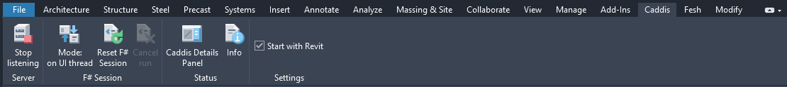
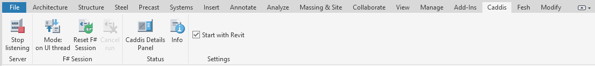
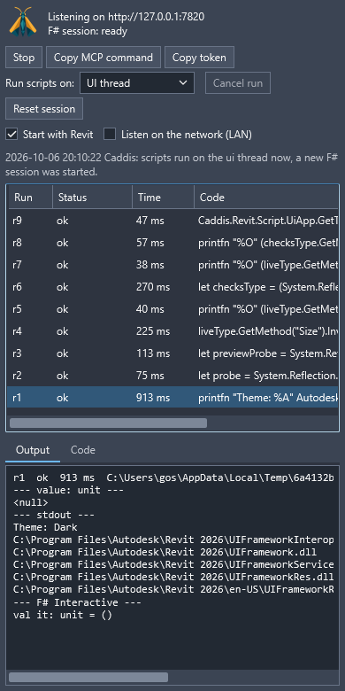
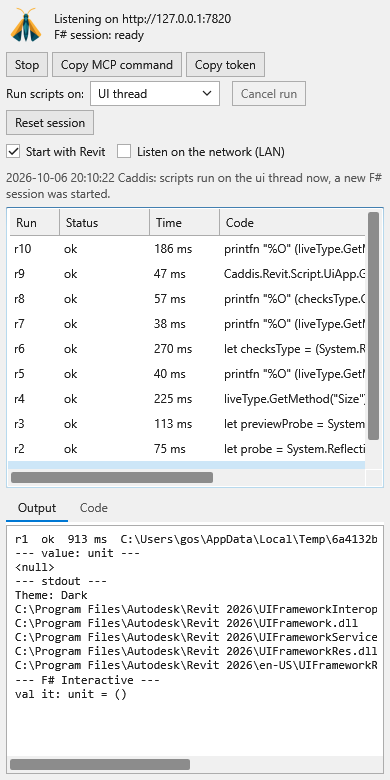

# Caddis for Revit

The Revit add-in of Caddis, an F# interactive host for Revit 2024 to 2027, controlled through HTTP and MCP.
It has the same F# session, HTTP server, REST endpoints and MCP tools as in Rhino,
except `caddis_command`: Revit has no command line. It adds `caddis_dialog` for Revit's dialogs.
See the [main README](../README.md) for what Caddis does, connecting an agent, the MCP tools and the REST endpoints.

> Tested in Revit 2024 and 2026.5.

## Installation
Just download and run `Caddis.Revit-win-Setup.exe` from the [latest release](https://github.com/goswinr/Caddis/releases/latest).

The exe is signed with an Azure code signing certificate.
It should not require admin rights to run. The installer is created with [Velopack](https://velopack.io/  )

It installs Caddis in `%LocalAppData%\Caddis.Revit` and registers it with every installed Revit from 2024 on,
with a `Caddis.addin` in `%AppData%\Autodesk\Revit\Addins\<year>`. For a Revit installed later, start `%LocalAppData%\Caddis.Revit\current\Caddis.Revit.Bootstrapper.exe` again.
When Revit starts, Caddis checks for a newer release and offers to download it. It is installed when the last Revit has closed.

There is a build of Caddis for each .NET that Revit runs on:

| Revit | .NET | Build | FSharp.Compiler.Service, FSharp.Core |
|---|---|---|---|
| 2024 | .NET Framework 4.8 | `net48`, the panel with Avalonia 11 | 43.12.401, 10.1.401 |
| 2025 and 2026, up to their .4 updates | .NET 8 | `net8.0` | 43.8.403, 8.0.403 |
| 2025 and 2026 from their .5 updates on, 2027 | .NET 10 | `net10.0` | 43.12.401, 10.1.401 |

Revit 2024 loads the net48 build. In Revit 2025 and later the add-in is [Caddis.Revit.Loader](../Caddis.Revit.Loader/CaddisLoader.cs),
which loads the net8.0 or the net10.0 build when Revit starts, for the .NET that Revit runs on.
So Caddis keeps working when Revit is updated from .NET 8 to .NET 10.
In Revit 2024 the panel uses Avalonia 11, since Avalonia 12 needs .NET 8.

The builds reference the Revit API of the oldest Revit they run in, from the package [Revit_All_Main_Versions_API_x64](https://www.nuget.org/packages/Revit_All_Main_Versions_API_x64):
2024.0 for net48, 2025.0 for net8.0 and net10.0. Revit on .NET fails to load an add-in that references a newer RevitAPI than its own, e.g. Revit 2025.5 has RevitAPI 25.5.

The versions of FSharp.Compiler.Service and FSharp.Core are those of the build of [Fesh](https://github.com/goswinr/Fesh) for the same .NET.
Revit loads only one version of them, so Caddis.Revit can run next to a Fesh.Revit only if it uses the same versions.

### Uninstallation
Uninstall it via Windows' native `Add or Remove Programs` settings.

### Installation for development
To start Revit with a local build, while the installed Caddis stays registered for every other start of Revit,
see [Dev/README.md](../Dev/README.md).

To register a local build for every start of Revit instead:
```
dotnet build Caddis.Revit -c Release
./Caddis.Revit/install-dev.ps1 -Year 2026 -Configuration Release
```
The script writes `Caddis.addin` to `%AppData%\Autodesk\Revit\Addins\2026`, pointing at the build output for the .NET of that Revit:
net48 for Revit 2024, otherwise as named in `RevitAPI.runtimeconfig.json` in the folder of Revit. `-Framework` picks a build.
It replaces the registration of the installer, start `Caddis.Revit.Bootstrapper.exe` to restore it.
On its first start, and after every rebuild, Revit asks whether to load the unsigned add-in, choose 'Always Load'.
Revit locks the dll while it runs, close Revit before building again. `install-dev.ps1 -Uninstall` removes the add-in.

## Ribbon

The Caddis tab groups its buttons in the panels **Server** with `Start` / `Stop`,
**F# Session** with `Mode`, `Reset F#` and `Cancel run`, and **Status** with `Panel` and `Info`.
Each button has its own Revit-style vector icon: pale gray surfaces with subtle depth,
blue accents and colored action markers. Icons are drawn for the screen's scale and
Revit's light or dark theme, with simplified details at 16 pixels. They need no icon font.
`Start` and `Stop` show the server's state in their text and icon, `Mode` the thread mode.

| Dark theme | Light theme |
| --- | --- |
|  |  |

The **Settings** panel has a native checkbox for **Start with Revit**. It shares the panel's setting and stays in sync
even while the panel is hidden.

Caddis' own messages go to `%AppData%\Caddis\revit.log`, `Info` shows the latest ones.

## Connect an AI agent
Revit has its own settings file `%AppData%\Caddis\settings-revit.json`, the default port 7820 and the MCP name `caddis-revit`,
so that Caddis in Rhino and in Revit can run and stay registered in Claude Code at the same time.
The panel sets up Claude Code, Codex and Claude Desktop, see [Connect an AI agent](../README.md#connect-an-ai-agent).
Without the panel, `Info` on the ribbon shows the commands while the server runs, Ctrl+C copies the text of its dialog:
```
claude mcp add --transport http --scope user caddis-revit http://127.0.0.1:7820/mcp
codex mcp add caddis-revit --url http://127.0.0.1:7820/mcp
```

With two Revits, only one listens on port 7820, where the agents connect, the other one on 7821.
Its panel shows the agents as inactive, and its `Activate` takes over port 7820 once the first Revit is idle.
The first Revit then listens on another port and logs that.

## Dockable panel

Open the panel with **Caddis → Panel** on Revit's ribbon. It shows the server
state, whether Claude Code, Codex and Claude Desktop connect to this Revit, settings, recent runs, and the selected run's output and code.
It docks next to the Project Browser, can be moved like any Revit pane,
and Revit remembers where it is and whether it is shown.
Its buttons show their messages in the pane instead of in dialogs.

Rhino and Revit use the same Avalonia view, styles and code viewer from `Caddis.UI`.
Revit supplies its actions and light or dark theme colors, and embeds the view in
a WPF `HwndHost` within its dockable pane. Styles stay scoped to Caddis.
The pane keeps its existing ID, so Revit retains the saved docking position.
It follows Revit's light or dark UI theme immediately, including dropdowns, run selection,
output, scrollbars and keyboard focus.

The code viewer is read-only, with F# highlighting, line numbers and Ctrl+F search.
The `Formatted` check box switches between Fantomas formatting and the original script, whose line
numbers match the diagnostics. `Export` saves the code of the run to an `.fsx` file,
`Export all` saves all successful F# runs to one, oldest first, each after a comment
with its id and time, both as the code is shown, formatted or not. `Settings` unfolds the thread mode
and **Start with Revit**. Revit's latest status message and grouped
element changes are preserved; Rhino's command-line options are hidden.

The shared view is covered by headless tests on .NET 8 and .NET 10. The WPF wrapper
has been checked in an isolated Windows host for native embedding, keyboard input,
tab focus, resizing, moving between windows and recreating its native content.
Live checks in Revit 2026.5 through Caddis verified script execution, run selection,
output, highlighting, formatting/original code, search event handling, automatic
light/dark themes, the autostart setting and hiding/reopening the pane. The model
was unchanged. The WPF shell fills its container without an outer margin, avoiding
black strips at the edges. Mouse/keyboard interaction and moving between monitors
still need manual verification.

Both screenshots were taken in Revit 2026.5 after the same five runs: the first two list the levels and create four walls,
the fourth fails because the project has no door type. The panel shows the output of the second run, which created the walls.

| Dark theme | Light theme |
| --- | --- |
|  |  |

## Differences to Rhino
- The Revit API can only be used in Revit's API context, being on the UI thread is not enough.
  Runs on the `ui` thread (the default) run inside an external event, which Revit runs only while no command, edit mode or modal dialog is active.
  Until then a run stays `running` and its result says it has not started yet.
- A Revit dialog, e.g. 'Project Not Saved Recently' or 'Unresolved References', blocks every call until it is closed.
  `caddis_status` and the results of runs still running name an open dialog with its text and buttons.
  `caddis_dialog` lists it or presses one of its buttons (REST: `GET /dialogs`, `POST /dialog`).
- Each run on the `ui` thread is wrapped in a transaction group. Scripts open their own transactions,
  or use `Caddis.Revit.Script.Transact("name", fun doc -> ...)`. If the run succeeds, its transactions are one undo step `Caddis r12`, which `caddis_undo` reverts.
  If it fails, Caddis rolls back all its changes.
  A failure to finalize the transaction group is also a failed run (`runtimeError`, MCP `isError: true`).
- Revit's warnings about the changes of a run, e.g. overlapping walls, are removed and listed in the notes of the result.
  An error rolls back its transaction instead of showing Revit's dialog.
- The result lists the ids of the elements a run created and deleted. Changed elements are counted per category,
  because Revit reports many it updates itself, e.g. schedules; their ids are saved to a file.
- In `background` mode every Revit API call must be inside `Caddis.Revit.Script.OnUi(fun () -> ...)` or `Script.Transact`.
  Each transaction is an undo step of its own, and a failed run is not rolled back.
- `caddis_undo` posts Revit's Undo command, which runs right after the call.
- `caddis_capture_viewport` uses `Document.ExportImage`: it shows the whole view or its crop region, not the zoom of the window.
  `displayMode` is a display style, e.g. `HiddenLine`, `Shading` or `Realistic`.
- `caddis_export` writes dwg, dxf, dgn, pdf, dwf and dwfx from the active view, fbx, obj, stl, step and sat from a 3D view,
  and ifc and nwc from the whole model. Exporting to STEP needs Revit 2025 or later.
  With `selected` or `objectIds`, element ids as strings such as `["316577"]`, Caddis isolates those elements in the view during the export.
  Exports of a large model take a while, e.g. 47 s for a 159 MB ifc of the Snowdon Towers sample.

## In scripts
RevitAPI, RevitAPIUI and `Caddis.Revit.dll` are referenced in every session:
```fsharp
Caddis.Revit.Script.Doc      // the active Document
Caddis.Revit.Script.UiDoc    // the active UIDocument, e.g. for the selection
Caddis.Revit.Script.UiApp    // the UIApplication
Caddis.Revit.Script.Transact("name", fun doc -> ...)  // a committed transaction, also in background mode
Caddis.Revit.Script.OnUi(fun () -> ...)  // in Revit's API context, needed in background mode
```
`Caddis.Revit.Script` also has `OutDir` and `RunId` of `Caddis.Script`.
`REVIT` is defined for `#if`, and `NETFRAMEWORK` in Revit 2024.

In Revit on .NET, scripts can't use WPF types, e.g. `System.Windows.Window`: F# Interactive type-checks against the .NET SDK's reference assemblies,
whose `WindowsBase.dll` is an empty stub that takes precedence over the real one, also with `#r`. Reflection works.

## Releases

A version tag starts the [Revit release workflow](../.github/workflows/release-revit.yml), see [Releases](../README.md#releases).
Its [packaging action](../.github/actions/package-revit/action.yml), which build CI runs too, publishes into the repository's `bin/publish/revit`
the app of the installer `Caddis.Revit.Bootstrapper.exe` for .NET Framework 4.8, and the folders `net48`, `net8.0`, `net10.0` and `loader`.
[Velopack](https://velopack.io/) packs, signs and uploads them as `Caddis.Revit-win-Setup.exe` to the GitHub release of the tag,
with the notes in [InstallNotes-revit.md](../.github/InstallNotes-revit.md), like [Fesh.Revit](https://github.com/goswinr/Fesh.Revit).
The bootstrapper writes the `.addin` files when Caddis is installed or updated and when it is started, and deletes them when Caddis is uninstalled.
Caddis in Revit starts it to check for updates when Revit starts, and to install a downloaded one when the last Revit closes.
So Velopack runs in its own process, not in Revit, where it could conflict with the Velopack of another add-in, e.g. of an older Fesh.Revit.

The workflow signs with Azure Trusted Signing, like Fesh.Revit, see [signing-metadata.json](../.github/signing-metadata.json). It needs:

1. A GitHub environment `releaseRevit` in the repository settings.
2. An Azure app registration with the role 'Trusted Signing Certificate Profile Signer' and a federated credential
   for the subject `repo:goswinr@884885/Caddis@1405302261:environment:releaseRevit`.
   This is GitHub's immutable subject with the ids of the owner and the repository, the default for new repositories.
   A failed Azure login prints the subject that GitHub sent.
3. Its ids as the Actions secrets `AZURE_CLIENT_ID`, `AZURE_TENANT_ID` and `AZURE_SUBSCRIPTION_ID`.
