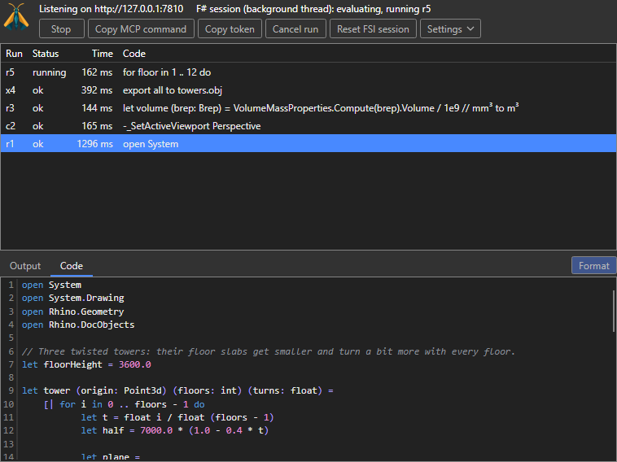
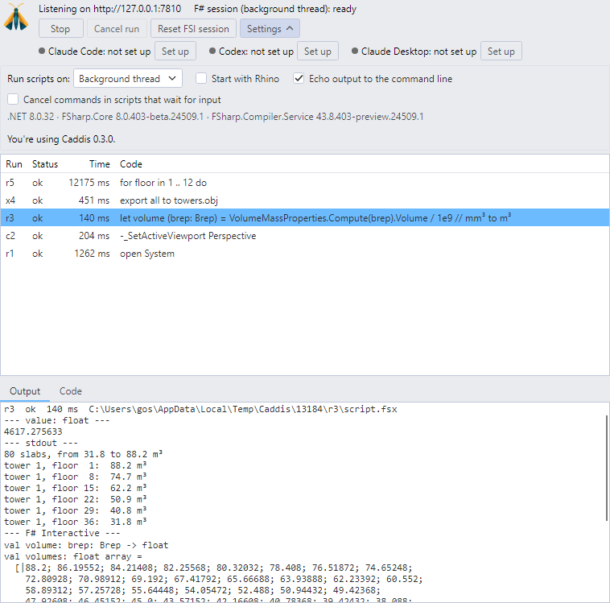
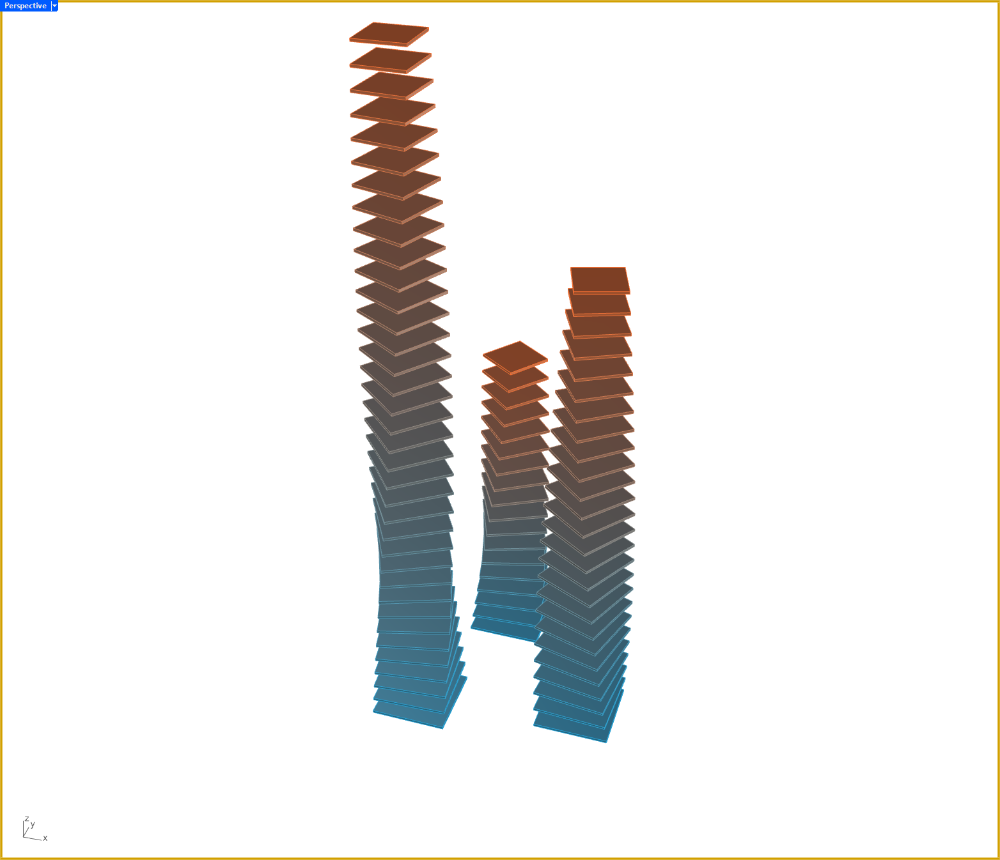

# Caddis for Rhino

The Rhino plugin of Caddis, an F# interactive host controlled through HTTP and MCP.
AI agents like Claude Code, and your own scripts, run F# code and Rhino commands in the Rhino you are working in.
See the [main README](../README.md) for what Caddis does, connecting an agent, the MCP tools and the REST endpoints.

> Tested in Rhino 8.35 and 9.0-beta on Windows, not yet on Mac.

## Installation

Install via Rhino's `PackageManager` command and search for `Caddis`.
The package supports Rhino 8.19 or later on Windows and Mac, running on .NET 8, and Rhino 9 Beta, which gets its own build for .NET 10.
On Windows it also runs in Rhino 8 on .NET Framework (see the Rhino command `SetDotNetRuntime`, or start Rhino with `/netfx`).
There the panel is drawn with Avalonia 11, since Avalonia 12 needs .NET 8.

Also install the [.NET SDK 10](https://dotnet.microsoft.com/download/dotnet/10.0) or newer, so that scripts can use NuGet packages via `#r "nuget: Name"`:
F# Interactive downloads them with the SDK. In Rhino 8 the .NET SDK 8 is enough. Caddis runs without it, the panel shows when it is missing.

Caddis can be loaded together with [Fesh.Rhino](https://github.com/goswinr/Fesh.Rhino),
both use the same versions of FSharp.Core and FSharp.Compiler.Service.
Caddis doesn't start a run while Fesh.Rhino runs a script, and Fesh.Rhino newer than 0.36.0 doesn't start a script while Caddis runs one.

### Manual installation

To run a local build while Caddis is installed from Yak, see [Dev/README.md](../Dev/README.md).

Without Caddis installed, build it with `dotnet build Caddis.Rhino/Caddis.Rhino.fsproj`,
then drag `Caddis.Rhino/bin/Debug/net8.0/Caddis.Rhino.rhp` into Rhino 8.
Rhino on .NET Framework loads the build in `bin/Debug/net48` next to it, Rhino 9 Beta the one in `bin/Debug/net10.0`.
The net10.0 build uses FSharp.Compiler.Service 43.12.401 and FSharp.Core 10.1.401, like Fesh.Rhino for Rhino 9, and has the panel.

## The Caddis command
Run the command `Caddis`. Its options:
- `Start` / `Stop` the HTTP server, by default on `http://127.0.0.1:7810`, or the next free port. On start it prints the commands to add Caddis to Claude Code and Codex.
- `Panel` opens the [Caddis panel](#the-caddis-panel).
- `Mode` runs scripts on the `UIThread` or in the `Background`. Changing it resets the F# session.
- `Cancel` the current run, `Reset` the F# session.
- `AutoStart` starts the server when Rhino starts.
- `EchoOutput` also writes the output of runs to the Rhino command line.
- `CancelWaitingCommands` (off by default, also a checkbox in the panel) cancels Rhino commands that an F# script starts, e.g. via `RhinoApp.RunScript`,
  when they wait 3 s for input that the macro doesn't give. The script goes on, the result has a note with the prompt.
  Without it such a command waits until someone gives the input in Rhino. In background mode only commands started via `Caddis.Script.OnUi` are watched,
  so commands you type in Rhino while a script runs are never cancelled.

It is scriptable, e.g. `-Caddis Start`.
The settings are saved in `%AppData%\Caddis\settings-rhino.json` on Windows and `~/.config/Caddis/settings-rhino.json` on Mac.

## While a run is in progress

All viewports get a dark yellow border while Caddis runs F# code, Rhino commands or an export,
so you can see when something other than you is working in Rhino:

- On the `UI thread` (the default) Rhino is blocked until the run ends. The border tells you why.
- On a `Background thread` Rhino stays usable, and the border warns you that a script may change the document while you work.

The border is drawn on layout pages but not around their details.
Captures with `caddis_capture_viewport`, `RhinoView.CaptureToBitmap` or `ViewCaptureToFile`, and prints, don't include it.

## The Caddis panel

Open it with the command `Caddis` and the option `Panel`, then dock it like any Rhino panel.
When Rhino closes, Caddis saves whether the panel is shown and where, in `panel-rhino8.json` or `panel-rhino9.json` in `%AppData%\Caddis`.
At the next start it moves the panel back if Rhino shows it elsewhere, e.g. after an update of Caddis:
docked, to the tabs of a panel it was docked with; floating, to its place on the screen, on Windows.
Its content is the Avalonia panel shared with Revit in `Caddis.UI`, hosted in Rhino's Eto docking container.
Rhino supplies its theme colors and the additional command-line settings.

Both screenshots were taken in Rhino 8.35 with Caddis 0.3.0, during and after the [exemplary run](#exemplary-run) below.

| Dark theme, during a run | Light theme, with the settings unfolded |
| --- | --- |
|  |  |

- The header shows where the server listens, and the state and thread mode of the F# session.
- `Start` / `Stop` the server.
- When a newer Caddis is on Yak, a notice says so: update it in Rhino's `PackageManager`.
  Once it is installed, the notice says that Rhino loads it when it restarts. Caddis checks Yak when Rhino starts.
- While it runs, whether Claude Code, Codex and Claude Desktop connect to this Rhino, with `Set up` or `Activate`,
  see [Connect an AI agent](../README.md#connect-an-ai-agent).
- `Cancel run` stops a run on the background thread, `Reset FSI session` starts a new F# session.
- `Settings` unfolds the thread mode and the options `Start with Rhino`, `Echo output to the command line`
  and `Cancel commands in scripts that wait for input`, and shows the versions of .NET, FSharp.Core, FSharp.Compiler.Service and Caddis, and whether this is the latest Caddis.
  All buttons and options have tooltips.
- The recent runs are listed newest first, with their id, status, duration and first line of code:
  `r` for F# code, `c` for Rhino commands, `x` for exports.
- `Output` shows the value, stdout, the Rhino command line, F# Interactive's output, errors and files of the selected run.
- `Code` shows its code read-only, with F# highlighting, line numbers and search (Ctrl+F).
  It is formatted with Fantomas, unchecking `Formatted` shows the code as it was run, whose line numbers match the errors.
  `Run again` runs the code of the selected F# run as a new run.
  `Export` saves the code of the run to an `.fsx` file, `Export all` saves all successful F# runs to one,
  oldest first, each after a comment with its id and time. Both save the code as it is shown, formatted or not.

The panel follows Rhino's light, dark or custom theme as soon as it changes.

## Rhino commands
`caddis_command` (REST: `POST /command`) runs Rhino command macros, as typed at the command line or in a button macro, e.g. `["-_Line 0,0,0 10,0,0", "_Zoom _All _Extents"]`,
one after the other until one does not succeed. It always runs on the UI thread.
It returns the result of each command, the ids of the objects they created, changed and deleted, the selection if it changed,
and the text they printed to the command line, e.g. of `_What`, `_Length` or `_Area`.
`select` selects objects by id before the first command. A command that waits for input that its macro doesn't give is cancelled
after `inputTimeoutMs` (default 3 s), the result shows its prompt; 0 waits for the person in Rhino, e.g. for `_Pause`.
A leading `!` is left out. Each command that changes the document is one undo step, `caddis_undo` undoes all of a call.
A command that opens a dialog blocks Rhino until someone closes it, so use the scripted `-` version of a command.

The results of F# runs also contain what was printed to the Rhino command line, e.g. by `RhinoApp.WriteLine` or by commands run via `RhinoApp.RunScript`.

Every run is wrapped in one Rhino undo record.
`caddis_capture_viewport` captures a viewport as PNG, `caddis_export` exports to any file format Rhino can write, except PDF.

## In scripts
RhinoCommon and System.Drawing.Common are referenced in every session.
Other assemblies of Rhino can be referenced by file name, e.g. `#r "Eto.dll"` or `#r "Rhino.UI.dll"`,
and NuGet packages via `#r "nuget: Name"`, which needs the .NET SDK 8 or newer, 10 in Rhino 9 (see [NuGet packages](../README.md#nuget-packages)).

In background mode, calls to RhinoCommon that touch the document or the UI go in `Caddis.Script.OnUi(fun () -> ...)`, as in the example below.
`RHINO` is defined for `#if`, and `NETFRAMEWORK` in Rhino on .NET Framework.

### Rhino.Scripting
[Rhino.Scripting](https://github.com/goswinr/Rhino.Scripting) has the 900+ functions of rhinoscriptsyntax for F#, named and used as in Python,
and [Rhino.Scripting.FSharp](https://github.com/goswinr/Rhino.Scripting.FSharp) adds curried versions for pipelines and extensions of RhinoCommon types.
While NuGet packages can be used, the MCP instructions suggest them to the agent for common tasks, e.g. adding objects, layers, names, colors and user text:

```fsharp
#r "nuget: Rhino.Scripting.FSharp"
open Rhino.Scripting
open Rhino.Scripting.FSharp
type rs = RhinoScriptSyntax

rs.AddPoint(1., 2., 3.) |>! rs.setLayer "Points"
```

Once the package is loaded, `caddis_describe` shows its functions with their docs, e.g. `RhinoScriptSyntax.ObjectLayer`.
Rhino.Scripting looks for Rhino's UI thread in Fesh.Rhino. Caddis gives it the UI thread too, so that its functions that use the UI work in background mode without Fesh.Rhino.
It also clears Rhino.Scripting's Esc state before each run, as Fesh.Rhino does: an Esc pressed in Rhino before, e.g. to deselect objects, doesn't make `rs.EscapeTest()` raise.
With Fesh.Rhino loaded, `rs.Get*` functions hide the Fesh window, also in Caddis runs. With Fesh.Rhino 0.36.0 or older, `rs.Print` in Caddis runs also writes to Fesh's log.

## Exemplary run

An agent sent these, the panel lists them newest first:

- `r1` adds three twisted towers of 80 floor slabs, via `caddis_eval`:
  <details open><summary>F# code</summary>

  ```fsharp
  open System
  open System.Drawing
  open Rhino.Geometry
  open Rhino.DocObjects

  // Three twisted towers: their floor slabs get smaller and turn a bit more with every floor.
  let floorHeight = 3600.0

  let tower (origin: Point3d) (floors: int) (turns: float) =
      [| for i in 0 .. floors - 1 do
             let t = float i / float (floors - 1)
             let half = 7000.0 * (1.0 - 0.4 * t)
             let plane = Plane(origin + Vector3d(0.0, 0.0, float i * floorHeight), Vector3d.ZAxis)
             let slab = Box(plane, Interval(-half, half), Interval(-half, half), Interval(0.0, 450.0)).ToBrep()
             slab.Rotate(t * turns * 2.0 * Math.PI, Vector3d.ZAxis, origin) |> ignore
             slab, Color.FromArgb(int (40.0 + 200.0 * t), int (160.0 - 50.0 * t), int (210.0 - 160.0 * t)) |]

  let slabs =
      Array.concat [
          tower (Point3d(0.0, 0.0, 0.0)) 36 0.25
          tower (Point3d(30000.0, 6000.0, 0.0)) 26 -0.2
          tower (Point3d(10000.0, 28000.0, 0.0)) 18 0.15
      ]

  // The geometry is computed on the background thread, the document is changed on Rhino's UI thread.
  Caddis.Script.OnUi(fun () ->
      let doc = Rhino.RhinoDoc.ActiveDoc
      for slab, color in slabs do
          let attributes = new ObjectAttributes(ColorSource = ObjectColorSource.ColorFromObject, ObjectColor = color)
          doc.Objects.AddBrep(slab, attributes) |> ignore)

  printfn "Added %d floor slabs." slabs.Length
  ```
  </details>
- `c2` sets up the view with Rhino commands, via `caddis_command`:
  `-_SetActiveViewport Perspective`, `-_MaxViewport`, `-_SetDisplayMode _Viewport=_Active _Mode=_Shaded`,
  four times `-_RotateView _Right`, and `_Zoom _All _Extents`.
- `r3` computes the volumes of the slabs. It uses `slabs` from `r1`: the values of earlier runs stay available.
- `x4` exports all objects to `towers.obj`, via `caddis_export`.
- `r5` runs for 12 s on the background thread, the viewport screenshot below was taken meanwhile.

This screenshot was taken in Rhino 8.35 on Windows with Caddis 0.3.0, while `r5` was running.



## Yak releases

Build and release CI use the same [packaging action](../.github/actions/package-rhino/action.yml).
It publishes the plugin and its dependencies into the repository's `bin/publish/rhino/rh8/net8.0`, `bin/publish/rhino/rh8/net48` and `bin/publish/rhino/rh9/net10.0`,
adds the Yak manifest, logo and license to `rh8` and `rh9`, then builds two distributions of the same version:
`bin/publish/rhino/caddis-<version>-rh8_19-any.yak` for Rhino 8 and `bin/publish/rhino/caddis-<version>-rh9_0-any.yak` for Rhino 9.
The package manager gives each Rhino version only its own distribution.

The [Rhino release workflow](../.github/workflows/release-rhino.yml) runs for a version tag, see [Releases](../README.md#releases).
It builds, tests, packages, checks the tag against the changelog, and pushes both packages to Yak.
Build CI also creates them on every push and pull request to `main`.
It needs a Yak CI token: generate one with `yak.exe login --ci` and save it as the repository Actions secret `YAK_TOKEN`.
