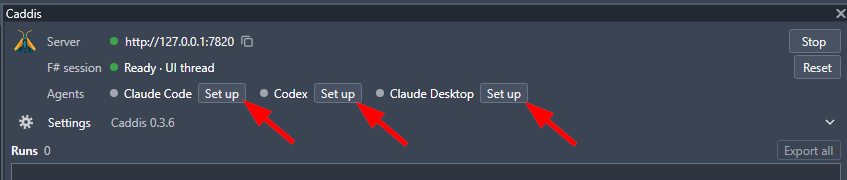
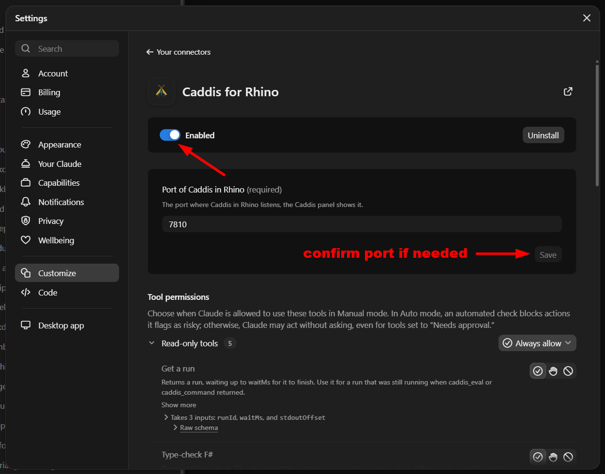

# Caddis

[](https://github.com/goswinr/Caddis/actions/workflows/build.yml)
[](https://github.com/goswinr/Caddis/actions/workflows/release-rhino.yml)
[](https://github.com/goswinr/Caddis/actions/workflows/release-revit-autocad.yml)


[](LICENSE)


Caddis lets an AI agent like Claude or Codex work in the [Rhino](https://www.rhino3d.com/), [Revit](https://www.autodesk.com/products/revit/overview) or [AutoCAD](https://www.autodesk.com/products/autocad/overview) you have open.
You describe what you want in plain words. The agent writes a short F# script that uses the app's API, Caddis runs it inside the app and sends back the result,
and the agent checks it, e.g. with a capture of the view, and corrects its script if needed.

You get the code it ran too: read it to learn the API, run it again, or make a permanent plugin from it.
This makes Caddis useful for automating your work and for trying out ideas quickly in Rhino, Revit and AutoCAD.

Technically, Caddis is an [MCP](https://modelcontextprotocol.io) server that hosts a persistent F# Interactive session inside the app,
where scripts use RhinoCommon, the Revit API or the AutoCAD .NET API.

## Getting started

### 1. Install Caddis in your app

| App | Runs in | Install | Read more |
|---|---|---|---|
| Rhino | Rhino 8.19 or later on Windows and Mac, Rhino 9 | In Rhino's `PackageManager`, search for `Caddis` or use [food4rhino](https://www.food4rhino.com/en/app/caddis) | [Caddis for Rhino](Caddis.Rhino/README.md) |
| Revit | Revit 2024 to 2027 on Windows | Run `Caddis.Revit-win-Setup.exe` from the [latest release](https://github.com/goswinr/Caddis/releases/latest) | [Caddis for Revit](Caddis.Revit/README.md) |
| AutoCAD | AutoCAD 2025 and later on Windows | Run `Caddis.AutoCAD-autocad-Setup.exe` from the [latest release](https://github.com/goswinr/Caddis/releases/latest) | [Caddis for AutoCAD](Caddis.AutoCAD/README.md) |

Also install the [.NET SDK 10](https://dotnet.microsoft.com/download/dotnet/10.0) or newer, so that scripts can use NuGet packages via `#r "nuget: Name"`.
It works for every version of Rhino, Revit and AutoCAD. Caddis runs without it, only NuGet packages need it, see [NuGet packages](#nuget-packages).

### 2. Install an AI agent

The Caddis panel sets up these agents for you:
- [Claude Desktop](https://claude.ai/download), the Claude app. You don't need a terminal for it.
- [Claude Code](https://claude.com/claude-code), Claude in the terminal or in VS Code.
- [Codex](https://github.com/openai/codex), OpenAI's agent in the terminal.

Other agents that can connect to an MCP server over HTTP work too. In Rhino its address is `http://127.0.0.1:7810/mcp`, see [the ports of the other apps](#4-connect-an-ai-agent).

### 3. Start Caddis and open its panel

| App | Open the panel | Start the server |
|---|---|---|
| Rhino | Run the command `Caddis` and choose `Panel` | `Start` in the panel |
| Revit | `Caddis Details Panel` on the `Caddis` ribbon tab | `Start listening` on the ribbon tab, or `Start` in the panel |
| AutoCAD | `Caddis Details Panel` on the `Caddis` ribbon tab | `Start listening` on the ribbon tab, or `Start` in the panel |

To start the server whenever the app starts, check `Start with Rhino`, `Start with Revit` or `Start with AutoCAD` in the panel's settings.

### 4. Connect an AI agent

While the server runs, the panel shows whether Claude Code, Codex and Claude Desktop are set up for Caddis in this app. Click `Set up` beside your agent:



The color of the dot shows where the agent's config points, its tooltip names it:
- **set up** (green): the agent is set up for this app.
- **not set up** (gray): `Set up` adds Caddis to the agent for all your projects, with the agent's own program, e.g. `claude mcp add ...`. For Claude Desktop it opens the extension `caddis-rhino.mcpb`, `caddis-revit.mcpb` or `caddis-autocad.mcpb`, and Claude Desktop asks to install it.
- **set up elsewhere** (amber): the agent is set up for another port, e.g. that of a second Revit with Caddis. `Switch here` asks the app on that port to hand it over once it is idle, with no run in progress, and waits for that. Then this app listens on that port, and the agents set up for it call this app. If the port can't be taken, e.g. another program uses it, `Switch here` sets the agent up for this app instead.

The dot says nothing about whether the agent runs: MCP over HTTP has no lasting connection, each request is on its own.
So beside the agent's name the panel shows how long ago its latest request to this app came, e.g. `just now` or `2.5 min ago`, and the tooltip names the request, e.g. `caddis_eval`.
The tooltip of the server's URL lists the latest request of every MCP client, also of those that the panel doesn't set up, e.g. Cursor.

If the agent was open already, restart it, or start a new session in it: sessions that were open before it was set up see Caddis only after a restart.

The tooltips of the buttons say step by step what they do, so nothing happens behind your back:
- `Set up` for Claude Code and Codex: the program it runs and where it found it, the exact commands, and the file the agent writes them to, `~/.claude.json` or `~/.codex/config.toml`. Caddis itself only reads these files. A right-click on the agent copies the commands, to run them in a terminal yourself.
- `Set up` for Claude Desktop: where it writes the extension and what is in it, how it opens it in Claude Desktop, and that Claude Desktop then runs its relay with its own Node, which passes each message on to Caddis.
- `Switch here`: the request to the app on the other port to hand it over, what happens while that app is busy, that no config file changes, and the `Set up` it runs if the port can't be taken.

<details>
<summary>Without the panel: the commands for Claude Code and Codex</summary>

Run the commands yourself in a terminal. Rhino prints them to its command line when the server starts,
Revit and AutoCAD show them in the `Info` dialog of the `Caddis` ribbon tab, where Ctrl+C copies its text. For Claude Code:
```
claude mcp add --transport http --scope user caddis-rhino http://127.0.0.1:7810/mcp
```

`--scope user` makes Caddis available across your Claude Code projects.

For Codex:
```
codex mcp add caddis-rhino --url http://127.0.0.1:7810/mcp
```

</details>

<details>
<summary>The ports and names of the apps</summary>

Each app has its own port and MCP name, so that they can run and stay registered in the agents at the same time:

| App | Display name | Default port | MCP name | Claude Desktop file |
|---|---|---|---|---|
| Rhino | Caddis for Rhino | 7810 | `caddis-rhino` | `caddis-rhino.mcpb` |
| Revit | Caddis for Revit | 7820 | `caddis-revit` | `caddis-revit.mcpb` |
| AutoCAD | Caddis for AutoCAD | 7830 | `caddis-autocad` | `caddis-autocad.mcpb` |

If the port is taken, the next free one is used, and the panel shows the agents set up for the port as set up elsewhere.

</details>

<details>
<summary>Claude Desktop: its extension and port</summary>

The extension that `Set up` opens is a `.mcpb` file with the port and the tools of the running app.
Each [release](https://github.com/goswinr/Caddis/releases) also has `caddis-rhino.mcpb`, `caddis-revit.mcpb` and `caddis-autocad.mcpb` for the default ports: drag one into the window of Claude Desktop, or open it.

In Claude Desktop, the extension's setting `Port of Caddis in Rhino`, `Port of Caddis in Revit` or `Port of Caddis in AutoCAD` must match the port of the Caddis panel.
Find it under Settings > Customize > Your connectors > `Caddis for Rhino`, `Caddis for Revit` or `Caddis for AutoCAD`, and confirm a changed port with `Save`.



While the app isn't running, the extension still lists its tools, and their results say to start the app.

On Windows, Claude Desktop isn't the app for `.mcpb` files after it is installed. If Windows asks which app to open it with, choose
`More apps` > `Look for another app on this PC` and `%LOCALAPPDATA%\AnthropicClaude\claude.exe`, with `Always`.
Claude Desktop from the Microsoft Store or an MSIX file isn't in that folder: drag the file into it, or choose it under Settings > Customize.

Claude Desktop can't use the URL of Caddis directly: it runs local MCP servers as programs only, and reaches the URLs of connectors
from Anthropic's servers, which can't reach your computer. That is why Caddis comes as a Claude Desktop extension,
whose small relay passes Claude Desktop's messages to Caddis on this computer. Claude Desktop brings the Node.js that runs it.

</details>

### 5. Ask for something

Name Caddis in your request, e.g.:
- In Rhino: "Use Caddis to draw a triangle, find its incircle center, divide it into 3 triangles and recurse 10 times, fade out the color".
- In Revit: "Use Caddis to list the walls in the active view with their types and lengths".
- In AutoCAD: "Use Caddis to draw a 1000 by 600 rectangle with a circle of radius 50 in each corner".

The panel lists each run of the agent with its code and output. `Run again` runs the code again, `Export` saves it to an `.fsx` file.
On the UI thread, the default, the app is busy until a run ends.
On Windows, the panel also recovers automatically if it misses a wake-up and stays frozen after the app responds again.

## How it works

<details>
<summary>Words used in this README</summary>

- **AI agent**: an AI assistant that can use tools on your computer, e.g. Claude Desktop, Claude Code or Codex.
- **MCP**, the [Model Context Protocol](https://modelcontextprotocol.io): the standard way for AI agents to use tools. Caddis is an MCP server: the agent connects to it and gets its tools, e.g. `caddis_eval`.
- **F#**: the .NET programming language of the scripts. You don't need to know it to start: the agent writes the code, and you can read it to learn.
- **F# Interactive**: runs F# code without building a project first. Caddis keeps one F# Interactive session in each app: what one run defines, the next can use.
- **Run**: one script, command or export that Caddis ran for the agent, with an id like `r1`. The panel lists them.
- **API**: the programming interface of the app, e.g. RhinoCommon in Rhino. Scripts call it to read and change the document.
- **.NET SDK**: Microsoft's tools to build .NET programs. Caddis needs it only for scripts that use NuGet packages.
- **NuGet package**: a library from [nuget.org](https://www.nuget.org), which a script loads with `#r "nuget: Name"`.
- **Server, port**: Caddis listens for agents at an address like `http://127.0.0.1:7810`. `127.0.0.1` is this computer, `7810` the port, a number that each app gets its own of.
- **REST**: plain HTTP requests, e.g. with `curl`, for your own scripts instead of an agent.

</details>

Caddis doesn't turn every method of the app's API into an MCP tool. It gives the agent a few tools to explore and use the API that is loaded in the running app:

1. `caddis_describe` looks up the API: it searches names, lists the types of a namespace, the members of a type and the overloads of a method, with their docs.
   So the agent uses the API of the app version you have installed, instead of guessing names.
2. `caddis_check` type-checks the F# code that the agent wrote, without running it.
3. `caddis_eval` runs the code in the app, and returns its result, its output and its errors.
4. `caddis_capture_viewport` captures a view as an image, so that the agent sees what its code did.

Every run is one undo step in the app, so you can undo what the agent did.

<details>
<summary>Everything Caddis does</summary>

- Hosts one persistent F# Interactive session inside the app.
  Values, functions and types defined in one run stay available in the next.
- Serves an MCP endpoint at `/mcp`, so AI agents can run F# in the app, and plain REST endpoints for curl and scripts.
- Returns results: status, the value of the last expression, stdout, stderr, compiler diagnostics, exceptions with the script line, notes of the app, e.g. Revit's warnings, and files.
  Via MCP as compact text for the model with images inline, long output shortened and saved to a file. Via REST as JSON.
- Runs scripts either on the app's UI thread (safest, the default) or on a background thread (cancellable, with timeouts).
- Wraps every run in one undo step, captures viewports as PNG, and exports to the file formats of the app.
- Looks up the signatures and docs of the loaded APIs, e.g. RhinoCommon, the Revit API or the AutoCAD .NET API, so agents don't have to guess API names and overloads.
- Shows the server state, the recent runs, and the output and code of the selected run in a panel docked in the app, in the app's light or dark theme.
- In Rhino and AutoCAD it runs commands like typed at the command line. In Revit and AutoCAD it lists blocking dialogs and presses their buttons.

</details>

What is specific to each app, its installation, commands, panel and API, is in [Caddis for Rhino](Caddis.Rhino/README.md), [Caddis for Revit](Caddis.Revit/README.md) and [Caddis for AutoCAD](Caddis.AutoCAD/README.md).

## Security

Caddis has no authentication: anyone who can send requests to it can run any code on your computer, with your rights.
That code can do more than change the document, e.g. change or delete files.
- The server only listens on localhost, so other computers can't reach it.
- Every program on this computer can reach it, also programs of other users signed in to it.
- Requests from web pages, with an `Origin` header, are rejected.

Stop the server when you don't use it, and read the code of the runs in the panel to see what the agent did.

## Reference

### MCP tools

| Tool | |
|---|---|
| `caddis_eval` | Run F# code or a script file in the session |
| `caddis_get_run` | A run, waiting for it if it is still running |
| `caddis_check` | Type-check F# code against the current session without running it |
| `caddis_describe` | Signatures and docs of namespaces, types and members of the loaded assemblies |
| `caddis_status` | State of the server, the F# session and the document |
| `caddis_cancel` | Cancel the current run, in background mode |
| `caddis_reset` | Start a new F# session |
| `caddis_set_mode` | Run scripts on the UI thread or in the background |
| `caddis_undo` | Undo a run in the app |
| `caddis_capture_viewport` | PNG of a viewport |
| `caddis_export` | Export to a file |
| `caddis_command` | Rhino and AutoCAD: run commands like typed at the command line, see [Rhino commands](Caddis.Rhino/README.md#rhino-commands) and [AutoCAD commands](Caddis.AutoCAD/README.md#autocad-commands) |
| `caddis_dialog` | Revit and AutoCAD: list the app's open dialog or press one of its buttons, see [Differences to Rhino](Caddis.Revit/README.md#differences-to-rhino) and [AutoCAD commands](Caddis.AutoCAD/README.md#autocad-commands) |

<details>
<summary>More on the tools: waiting, cancelling, checking, describing and exporting</summary>

`caddis_eval` returns after `waitMs` (default 50 s) with status `running` if the run has not finished, it keeps running and
`caddis_get_run` waits for it. `timeoutMs` cancels a run, only in background mode.
Cancellation skips queued `Script.OnUi` callbacks. A callback already executing in the app must finish first;
the run stays busy until it returns, then cancellation stops the script before it continues.

`caddis_check` type-checks against the current session, so definitions from earlier runs are known,
but not the definitions in files loaded with `#load`.

`caddis_describe` looks up types and members of the loaded assemblies and returns their signatures in F# syntax
with the summaries from their XML doc files:
a namespace (`Rhino.Geometry`) lists its types, a type (`Brep`) its members, a member (`Brep.CreateFromBox`) all overloads with docs.
`search` finds names, e.g. `fillet`. Misspelled names get suggestions.
F# modules are found only by their compiled names, e.g. `Microsoft.FSharp.Collections.ListModule.Map` for `List.map`.

`caddis_export` is a run like `caddis_eval`: it returns `running` after `waitMs`, and `caddis_get_run` returns its files.
An explicit `objectIds` array must be nonempty and contain only valid ids of the app.

MCP results are text written for the model, without `structuredContent`:
Claude Code shows the model only the `structuredContent` of a result that has one ([#55677](https://github.com/anthropics/claude-code/issues/55677)).

Packages can ship guides for agents as MCP resources. Once an assembly of such a package is loaded with `#r "nuget: ..."`, `resources/list` lists its files, e.g. the guide of Rhino.Scripting, and `resources/read` returns them. They are documents to read, not tools.

</details>

### NuGet packages

Scripts can reference NuGet packages via `#r "nuget: Name"`. F# Interactive restores them with `dotnet msbuild`, so they need a .NET SDK of the app's .NET version or newer,
e.g. the .NET SDK 8 in Rhino 8 or Revit 2025, and any SDK on .NET Framework. Everything else works without an SDK.

<details>
<summary>How Caddis finds the SDK, and what happens without it</summary>

Caddis finds `dotnet` where F# Interactive does: `DOTNET_HOST_PATH`, next to the running .NET runtime, on `PATH`, then in `Program Files\dotnet`.
Without a suitable SDK
- `caddis_status` and `/status` report it under `nuget`, with the reason and the download page,
- the description of `caddis_eval` and the instructions on `initialize` tell the agent, which can pass the advice on to the person, and in Rhino the instructions leave out the suggestion of [Rhino.Scripting](Caddis.Rhino/README.md#rhinoscripting),
- a failed run with `#r "nuget:"` gets a note explaining it: F# Interactive's own error doesn't mention the SDK,
- the panel recommends installing the SDK, with a button to its download page.

An SDK installed while the app runs is found within 10 s.

</details>

### REST

For your own scripts, without an agent, Caddis has plain HTTP endpoints that return JSON, e.g.:
```
curl http://127.0.0.1:7810/eval -d "{\"code\": \"1 + 1\"}"
```

<details>
<summary>All REST endpoints</summary>

| Endpoint | |
|---|---|
| `GET /status` | State of the server and the F# session |
| `POST /eval` | `{code?, path?, waitMs?, timeoutMs?, recordUndo?}`, returns the run, status 202 if still running after `waitMs`. Without `waitMs` it waits until the run finished |
| `GET /runs`, `GET /runs/{id}?waitMs=` | Recent runs, one run, optionally waiting for it |
| `POST /cancel` | `{runId?}`, background mode only |
| `POST /reset` | New F# session |
| `POST /mode` | `{mode: "ui" \| "background"}` |
| `POST /check` | `{code?, path?}`, type-check against the current session without running |
| `GET /describe?name=&filter=&search=` | Signatures and docs of a namespace, type or member, or a search of names |
| `POST /undo` | `{runId?}`, undo a run in the app |
| `GET /viewport?view=&width=&height=&displayMode=` | PNG of a viewport |
| `POST /export` | `{format, name?, objects?: "all" \| "selected", objectIds?, waitMs?}`, an export is a run like `/eval` |
| `GET /files/{id}/{name}` | A file of a run, capture or export |
| `POST /command` | Rhino and AutoCAD: `{commands, select?, inputTimeoutMs?, waitMs?}`, runs commands of the app, returns the run like `/eval` |
| `GET /dialogs`, `POST /dialog` | Revit and AutoCAD: the app's open dialog, `{button, dialog?}` presses a button of it |
| `GET /help` | A short description of all endpoints |
| `POST /mcp` | MCP endpoint |

</details>

### In scripts

Caddis adds to every session:
```fsharp
Caddis.Script.OutDir   // a folder for files of this run, they are returned with the result
Caddis.Script.RunId    // e.g. "r12"
Caddis.Script.OnUi(fun () -> ...)  // run code on the app's UI thread, needed in background mode for calls into the app
```
Each app references its API in every session. For its APIs and helpers, see [scripts in Rhino](Caddis.Rhino/README.md#in-scripts),
[scripts in Revit](Caddis.Revit/README.md#in-scripts) and [runs in AutoCAD](Caddis.AutoCAD/README.md#how-runs-work-in-autocad).

<details>
<summary>Symbols for <code>#if</code>, to run a script in several apps or runtimes</summary>

| Symbol | Defined |
|---|---|
| `CADDIS` | in every Caddis session |
| `RHINO`, `REVIT`, `AUTOCAD` | in the app of that name |
| `NETFRAMEWORK` | on .NET Framework, in Rhino 8 on Windows and Revit 2024 |
| `NET`, `NETCOREAPP` | on .NET 8 and later |
| `INTERACTIVE` | by F# Interactive itself, in every session |

`extraFsiArgs` in the settings file of the app can add more, e.g. `"--define:MYSYMBOL"`.

</details>

### Files

Caddis keeps its settings and logs in `%AppData%\Caddis` on Windows and in `~/.config/Caddis` on Mac.

<details>
<summary>The files in that folder</summary>

| File | |
|---|---|
| `settings-rhino.json` | The settings of Caddis in Rhino |
| `settings-revit.json` | The settings of Caddis in Revit |
| `settings-autocad.json` | The settings of Caddis in AutoCAD |
| `panel-rhino8.json`, `panel-rhino9.json` | Whether the panel is shown in Rhino and where, restored when Rhino starts |
| `instances\<process id>.json` | The port of each running server |
| `revit.log` | Caddis' own messages in Revit |
| `revit-update.json` | The result of the latest update check in Revit, which the panel and `Info` show |
| `autocad.log` | Caddis' own messages in AutoCAD |
| `autocad-update.json` | The result of the latest update check in AutoCAD, which the panel and `Info` show |

</details>

## Feedback

If something doesn't work in your Rhino, Revit or AutoCAD, or you miss a feature, please [open an issue](https://github.com/goswinr/Caddis/issues).
Name the app and its version, and the version of Caddis, which the panel shows beside `Settings`. Add what shows the problem:
- Screenshots of the panel, of the app and of the agent, e.g. of an error message.
- The code and output of the run that failed, from the panel. `Export` saves its code to an `.fsx` file.
- The log of Caddis:
  - Rhino writes Caddis' messages to its command line. Copy them from the command history: run the command `CommandHistory`, or press F2 on Windows.
  - Revit writes them to `%AppData%\Caddis\revit.log`, together with the messages of the installer and of updates.
  - AutoCAD writes them to its command line and to `%AppData%\Caddis\autocad.log`.

To open that folder, type `%AppData%\Caddis` into the address bar of the File Explorer.
Issues are public, so check that your screenshots and logs show nothing you want to keep private.

## Development

To build Caddis yourself, you need Windows with the .NET 8 and .NET 10 SDKs:
```
dotnet build Caddis.slnx
dotnet test Caddis.slnx
```
See [Architecture.md](Architecture.md) for the design, the API and what is not there yet.

<details>
<summary>The projects</summary>

| Project | |
|---|---|
| `Caddis.Core` | The F# session, HTTP server, REST and MCP, without a Rhino, Revit or AutoCAD dependency, tested with a headless host |
| `Caddis.UI` | The shared Avalonia panel, styles, output formatting and code viewer |
| `Caddis.Rhino` | The Rhino plugin, see [Caddis for Rhino](Caddis.Rhino/README.md) |
| `Caddis.Revit` | The Revit add-in, see [Caddis for Revit](Caddis.Revit/README.md) |
| `Caddis.Revit.Loader` | Loads the build of `Caddis.Revit` for the .NET of Revit 2025 and later |
| `Caddis.Revit.Bootstrapper` | The app of the Revit installer, it registers the add-in and installs updates |
| `Caddis.AutoCAD` | The AutoCAD plugin, see [Caddis for AutoCAD](Caddis.AutoCAD/README.md) |
| `Caddis.AutoCAD.Loader` | Loads the build of `Caddis.AutoCAD` for the .NET of AutoCAD |
| `Caddis.AutoCAD.Bootstrapper` | The app of the AutoCAD installer, it registers the plugin and installs updates |
| `Tests` | Tests of Core, and of the shared panel with Avalonia's headless platform on both runtimes |

`Caddis.Core` and `Caddis.UI` target `net8.0;net10.0` with Avalonia 12, and `net48` for Rhino and Revit 2024 on .NET Framework, with Avalonia 11.
Each app supplies the panel's actions, theme colors and docking wrapper: Eto in Rhino, WPF `HwndHost` in Revit and AutoCAD.
What differs between them, the texts of the MCP tools, the id format of objects and whether there are commands, comes from `ICaddisHost.Info`.

</details>

### Run a local build in Rhino, Revit or AutoCAD

To start Rhino, Revit or AutoCAD with a local build instead of the installed Caddis, double-click e.g. `Dev\Rhino8.cmd`, `Dev\Revit2026.cmd` or `Dev\AutoCAD2025.cmd`, see [Dev/README.md](Dev/README.md).

### Releases

The package version and assembly versions come from the latest versioned entry in [CHANGELOG.md](CHANGELOG.md),
using `Ionide.KeepAChangelog.Tasks`, as in Fesh.Rhino. To publish a release:

1. Add a versioned entry to `CHANGELOG.md`, for example `## [0.1.0] - 2026-10-10`, and commit it.
2. Push a matching tag, for example `0.1.0` (without a `v` prefix).

The tag starts two release workflows, each needs a one-time setup:
[Yak packages for Rhino](Caddis.Rhino/README.md#yak-releases) and [the Revit and AutoCAD installers](Caddis.Revit/README.md#releases).

## License

[MIT](LICENSE)
